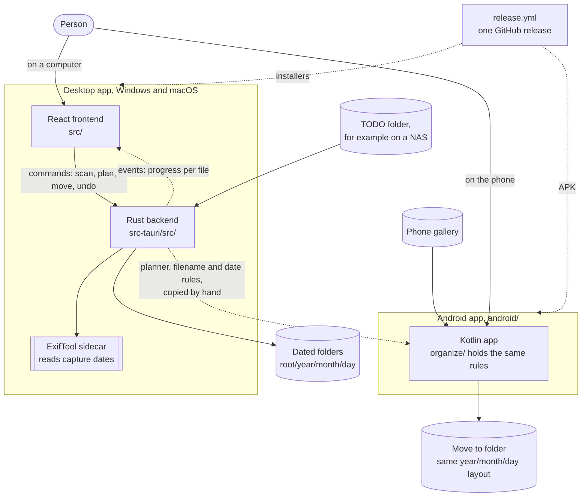
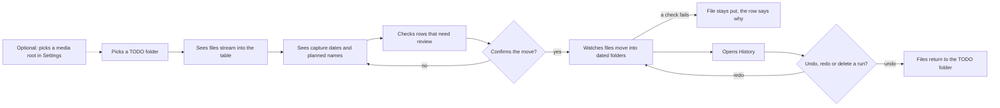

# Media Organizer

Windows and macOS desktop app that moves photos and videos into folders by year, month and day. It reads when each file was taken with a bundled ExifTool sidecar.

## Install

One command installs the latest release. No clone needed.

Windows, in PowerShell:

```powershell
irm https://raw.githubusercontent.com/oleg-chibikov/media-organizer/main/install.ps1 | iex
```

Windows, in Command Prompt (`cmd`):

```bat
powershell -NoProfile -ExecutionPolicy Bypass -Command "irm https://raw.githubusercontent.com/oleg-chibikov/media-organizer/main/install.ps1 | iex"
```

macOS, in Terminal:

```sh
curl -fsSL https://raw.githubusercontent.com/oleg-chibikov/media-organizer/main/install.sh | sh
```

- **Windows** installs for the current user, no admin rights needed.
- **macOS** puts the app in `/Applications`, or `~/Applications` when `/Applications` is read-only.
- **Version** each script prints the version it installs. Release files carry it in their names.
- **Update** by running the same command again.

## Logs

The app writes its log to the console window on Windows and to a file.

- **Windows** `%LOCALAPPDATA%\com.mediaorganizer.desktop\logs`
- **macOS** `~/Library/Logs/com.mediaorganizer.desktop`
- **What it holds** scans, moves, undo and redo steps, errors and ExifTool warnings.

The app window, the Windows console and the Android screen show the version in their title. Local builds show `0.2.0` on desktop and `dev` on Android.

## How The Parts Fit



- **Desktop** the frontend only shows and asks. The backend scans, plans and moves files.
- **Android** runs alone on the phone and shares no code. A rule change in the backend needs the same change in `android/`.
- **Release** each push to `main` builds the Windows installer, the macOS DMGs and the APK into one release.

Each part has its own flow and code diagrams. The links are under Docs at the end of this page.

## Android

`android/` holds an Android app that moves the phone gallery into dated folders with the same rules. Get `MediaOrganizer-<version>-android.apk` from the [latest release](https://github.com/oleg-chibikov/media-organizer/releases/latest), or build it from scratch with no Android tools installed:

- **macOS or Linux** `./android/build-apk.sh`
- **Windows** `powershell -ExecutionPolicy Bypass -File android\build-apk.ps1`

The APK lands in `android/dist/media-organizer.apk`. Details are in `android/README.md`.

## Release

Each push to `main` publishes a new GitHub release. Pushes that change only `*.md`, `docs/` or `specs/` don't.

- **Version** the `Release` workflow raises the patch of the latest `vX.Y.Z` tag, for example `v0.2.0` to `v0.2.1`, and tags the commit.
- **Minor or major** run `gh workflow run release.yml -f bump=minor`, or `major`.
- **Assets** the Windows installer, a macOS DMG for each chip, and the signed Android APK.
- **Early downloads** the release shows up as a pre-release right away. Each asset appears once its build ends. The release becomes latest when all builds pass.
- **Version in files** `package.json`, `Cargo.toml` and `tauri.conf.json` stay as they are. The build takes the version from the tag.

## What It Does

- Scans a selected TODO folder recursively.
- Skips files already under `Processed/`.
- Reads photo/video capture dates from metadata, not filename dates.
- Streams destination previews as metadata becomes available.
- Moves only after explicit confirmation.
- Avoids overwrites with conflict suffixes and execution-time conflict checks.
- Falls back from rename to copy-verify-keep-source for NAS/cross-device behavior.
- Stores processing history in appData for inspection, undo, and redo.
- Supports either legacy `<selected folder>/Processed` destinations or a persisted custom media root.
- Renames files where they are, with **Rename only** in the toolbar. Files keep their folder and get the dated name.
- Suggests trip and outing folders from GPS and dates. The Group by place button in the toolbar shows progress while it looks up locations, then opens the review, or says why it found none. Rename the folders, then apply. The Place column in the table shows where each photo was taken, with a spinner while it looks.
- Continues a trip or outing folder an earlier run filled when the next scan starts within 3 days of it. The new files get the same folder name and year, and placed files move to new day folders when the span grows.
- Puts places abroad in a country folder: `<year>/<country>/<place>`. A trip across two countries becomes one folder per country. Places in home's country keep `<year>/<trip>/<place>` or `<year>/<place>`.
- Keeps places inside a month folder when you open one of a library sorted by date, such as `2026/5`: `2026/5/USA/<place>` or `2026/5/<place>`. Other files stay where they are. When a country abroad already has files in another month of that year, all of them go to `2026/USA/<place>`, and the review says which month folders move up. Undo puts them back. Opening a month again leaves files already in a place folder there.
- Measures trips from home. On first start with no home, the app reads the device location once on macOS and saves the nearest city. macOS asks for location access. Without access the app guesses home from the system time zone, such as Sydney for `Australia/Sydney`. A scan with 60 or more days in one city replaces that guess. Change it, clear it or press Use current location under Home in Settings. The Android app has no place folders, so it doesn't ask for location.

## User Flow



The frontend and backend views of the same flow are in `src/README.md` and `src-tauri/README.md`.

## Stack

- Frontend: React, TypeScript, Vite, Tailwind CSS.
- Desktop shell: Tauri 2.
- Backend: Rust.
- Metadata: bundled ExifTool sidecar.
- Tooling: `mise`, `pnpm`, `cargo`.

## Development

All project tools must be run through `mise`.

```powershell
mise x -- pnpm install
mise x -- pnpm tauri dev
```

Useful checks:

```powershell
mise x -- pnpm test
mise x -- pnpm lint
mise x -- cargo test --manifest-path src-tauri/Cargo.toml
mise x -- pnpm build
```

Find unused code, as the `Unused code` CI workflow does:

```powershell
mise x -- pnpm knip
mise x -- cargo shear src-tauri
```

Rebuild the offline place table in `src-tauri/assets/geodata.tsv.gz` from GeoNames. The script downloads about 640 MB into `scripts/geodata/.cache`:

```powershell
python3 scripts/geodata/build_geodata.py
```

## Third-party data

Place names come from [GeoNames](https://www.geonames.org/), licensed under [CC BY 4.0](https://creativecommons.org/licenses/by/4.0/).

## Docs

- Architecture, and the commands and events between frontend and backend: `docs/architecture.md`
- Frontend overview, flows and diagrams: `src/README.md`
- Backend overview, flows and diagrams: `src-tauri/README.md`
- ExifTool sidecar setup: `docs/exiftool-sidecar.md`
- Android app, flows and diagrams: `android/README.md`
- Agent conventions: `docs/agent/README.md`
- Feature specs: `specs/`
- Agent rules: `AGENTS.md`
