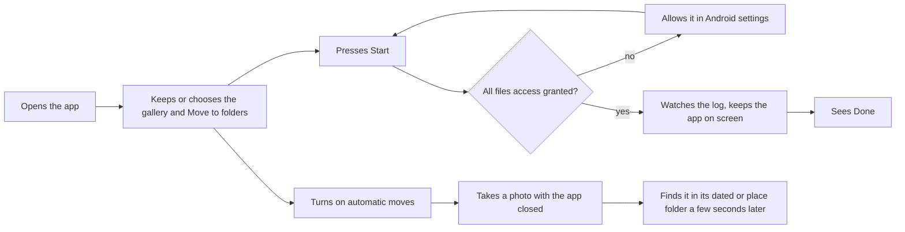
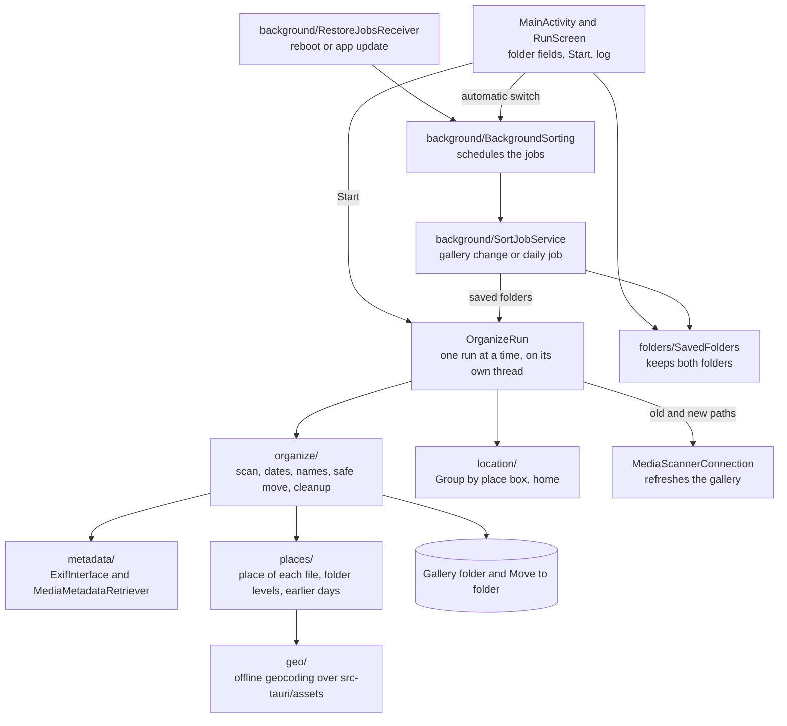

# Media Organizer for Android

Moves photos and videos from the phone gallery into folders by year, month and day, and by place, with the same rules as the desktop app.

## Install

Download `MediaOrganizer-<version>-android.apk` from the [latest release](https://github.com/oleg-chibikov/media-organizer/releases/latest) on the phone and open it. Android asks once to allow installs from the browser.

## Build the APK from scratch

Clone the repo, then run one command from the repo folder. The script needs no Java, Android SDK or Android Studio.

macOS or Linux, in Terminal:

```sh
./android/build-apk.sh
```

Windows 10 or 11, in PowerShell or Command Prompt:

```bat
powershell -ExecutionPolicy Bypass -File android\build-apk.ps1
```

- **First run** downloads JDK 17, the Android SDK and Gradle into `android/.tools`, about 1 GB, and libraries into `~/.gradle`.
- **Later runs** reuse `android/.tools` and download only what is missing.
- **Output** is `android/dist/media-organizer.apk`, signed with the local debug key.
- **Tests** run when you add `test` to the command.

A locally built APK and a release APK have different keys. To switch between them, uninstall the app first.

## Use it

1. Open the app. The gallery folder starts as `~/DCIM/Camera`, and "Move to" as `<gallery folder>/Processed`. `~` stands for the phone storage, `/storage/emulated/0`.
2. Press Choose next to a field to pick another folder, or type a path that starts with `~/` or `/`. The app keeps both folders after it closes.
3. Press Start. The first time, Android asks for access to all files. Allow it and press Start again. Choose asks the same way.
4. Keep the app on screen until the line under Start says Done. Android pauses a backgrounded app.

Choose opens a folder list inside the app. Tap a folder to open it, and "↑ Up" to go one level up. "Use this folder" picks the open folder. Back closes the list.

Choose next to "Move to" creates the folder first when it doesn't exist yet, so the picker opens inside it.

"Group by place" is on by default. Turn it off, and every file goes to its dated folder. The automatic moves read the box too. The text under the box says what it does.

The Home row shows home and where it came from, as on desktop:

- **Change** finds a city by name, or uses the current location.
- **Clear** forgets home. The next launch finds it again.
- **On launch** with no home or only a time zone guess, the app asks once for approximate location. Without it, the time zone names home.
- **The log** of each run names the home it went by and how many files have a place.



## Move new photos automatically

Turn on "Move new photos and videos automatically". The app then moves each new photo or video into its dated folder a few seconds after the camera saves it, with the app closed.

- **Folders** are the last ones on screen. Change a field and the next run uses it.
- **No app runs in between.** Android starts the app when the gallery changes, and the app exits after the run. Once a day it also goes through the whole gallery folder, for files the trigger missed.
- **Battery** Android asks once to let the app run in the background. Allow it, or Android may hold new photos back for hours. Phones such as Xiaomi also need "Autostart" on for the app.
- **Reboot** keeps the setting. Force stop in the system settings turns it off until the next app launch.
- **Start** waits while a background run moves files. Press it again a few seconds later.

## What matches the desktop app

- **Folders** `<root>/<year>/<month>/<day>/<date> (<original>) - <device>.<ext>`.
- **Places** a file with GPS goes to the folder of its city, park or sight, as in `2024/Japan/3/Kyoto/15`. Home's city gets no place folder, and home's country no country folder. A file with no GPS joins a file from the same device taken within 3 hours.
- **Home** picked by you beats your location, which beats one learned from 60 days of photos, which beats the time zone. A weaker source doesn't replace a stronger one.
- **Trips** the first day in a place goes to `2026/3/5/Japan/Kyoto`. A second day lifts the place to the month: `2026/3/Japan/Kyoto/5` and `/6`. A second month lifts it to the year.
- **Earlier days** of a place already in "Move to" move into the place's new folder, so a trip shot over days ends in one folder.
- **Dates** come from the same tags in the same order, ending with the file date.
- **Conflicts** get a ` (n)` suffix. A file with the same bytes already there stays in place.
- **Skipped** files are anything under `Processed`, the destination, and non-media files.
- **Cleanup** removes source folders the run emptied, but keeps the gallery folder.

## How the app keeps photos safe

- **No overwrite.** A move checks the name is free right before it renames. A taken name fails the file, and both files stay.
- **Earlier days** move the same way. A name another file holds gets a ` (n)` suffix, and a file with the same bytes there stays where it was. A run stopped at any point leaves each photo in its old folder or its new one. `TripTest` checks this after every step.
- **Files still saving stay.** A camera writes a new file under a hidden `.pending-` name, and the app skips hidden files.
- **Another storage** such as an SD card gets a hidden copy first. The app syncs it, checks the bytes, then gives it the name. The source goes last, and only when no app changed it meanwhile.
- **Deletes** touch only empty folders and the app's own temporary copies.

## What differs

- **Metadata** comes from Android's `ExifInterface` and `MediaMetadataRetriever` instead of ExifTool.
- **Device name** of a file without a camera model is the phone's own model. Android doesn't expose the camera model of a video, so every video gets it.
- **Home** is found once on launch, as on desktop on start, with Android's approximate location instead of CoreLocation. Background runs don't look for it.
- **Place tables** add about 11 MB to the APK. The first run with GPS photos loads them, which takes a few seconds.
- **Hidden files** such as `.trashed-*` and `.pending-*` stay put. They belong to the Android gallery.
- **History and undo** don't exist. The log on screen shows the last 300 moves.

## How the code fits



The sorting code is a copy of `src-tauri/src/planner`, `filename` and `metadata/date_selection.rs`. A rule change there needs the same change in `app/src/main/java/com/mediaorganizer/android/organize`. The same goes for `src-tauri/src/geo` and `geo/`, and for `file_places` and `places/`.

## Release signing

The `Release` workflow signs the APK with the key in the `ANDROID_KEYSTORE_BASE64` and `ANDROID_KEYSTORE_PASSWORD` repo secrets. One key for every release lets a new APK install over the old one. A new key means uninstalling the app once.
