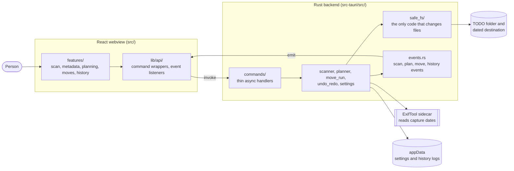
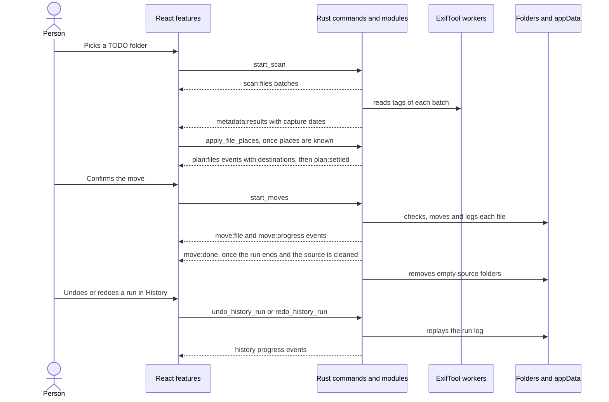
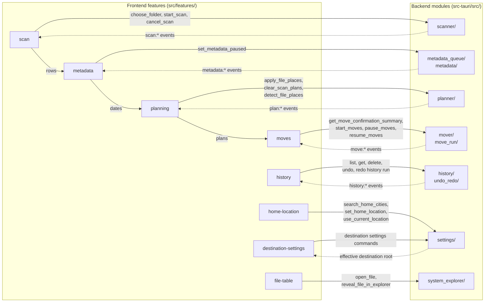

# Architecture

Media Organizer is a Tauri 2 desktop app. The Rust backend owns every filesystem decision: scanning, metadata, planning, moves, history, settings and safety checks. The React frontend renders backend state, queues work and sends confirmed batches.

## Big Picture

## Main Flow

1. The user picks a TODO folder. `features/scan` clears the old folder's rows, metadata, plans and moves, then calls `start_scan`. Events from the replaced scan are dropped until the new one starts.
2. `scanner` walks the folder on the blocking pool and streams `scan:*` events.
3. `scan_metadata` takes each batch of photos and videos right after its `scan:files` event and reads them through the persistent ExifTool workers of `metadata_queue`. It streams `metadata:results` and ends with `metadata:finished`. Both carry the `scan_id` from `scan:started`, so `features/metadata` drops dates of a replaced scan. The same request reads `GPSLatitude#`, `GPSLongitude#` and `GPSCoordinates#`, so each `MetadataResult` carries `gps` in signed decimal degrees, or `null`.
4. `scan_session` plans each file once its date is read and the place folders are known. `apply_file_places` tells it the place of each file, see Place Folders. Each planning pass sends one `plan:files` event with its plans, errors and the `scan_id`. The destination layout is read once per set of places. One lock orders every planning pass of a scan, so `features/planning` mirrors the events as they land. Every plan of a scan shares one set of reserved names, so two files planned in different passes don't get the same destination.
5. After the user confirms, `features/moves` calls `start_moves`. A thread of `scan_session` moves every ready file through `move_run`, then the files that become ready while the scan, its reads or its place folders are still going. `move_run` checks, moves and records each file and streams `move:*` events. Once nothing is left to check, the session removes the empty source folders and sends `move:done`.
6. `history` keeps a JSONL log per run in appData. `undo_redo` replays a run in either direction and streams `history:*` events.

## How Frontend And Backend Talk

Each frontend feature calls its own commands through `lib/api/`. The backend answers with events, or with the command result for metadata and settings.

- **Solid arrows** are commands, sent with `invokeCommand` in `lib/api/`.
- **Dotted arrows** are what comes back. Events arrive through `listenAll` and `useBackendEvents`. Move events, metadata results and plans go through `lib/useBufferedFlush.ts`. Scan rows have their own buffer. A large folder costs a few renders a second instead of one per file.
- **Arrows inside the frontend** pass data between features through `app/useAppSession.ts`.
- **Ids, not records** the backend keeps each scan's records and dates in `scan_session`, so commands get file ids or plans. A folder of 100,000 files doesn't cross IPC again on every plan or move.
- **Startup** `app/useBackendBootstrap.ts` calls `health_check` and `get_destination_settings`.

## Layering

Each layer may depend only on the layers below it.

| Layer         | Backend (`src-tauri/src`)                                         | Frontend (`src`)                                      |
| ------------- | ----------------------------------------------------------------- | ----------------------------------------------------- |
| Entry         | `main.rs` registers state and commands                            | `main.tsx`, `App.tsx` lays out features               |
| Orchestration | `commands/` thin async handlers                                   | `app/` wires features together                        |
| Features      | domain modules listed below                                       | `features/<name>/`, used only through `index.ts`      |
| Shared        | `models/`, `events.rs`, `path_safety.rs`, `file_ops/`, `safe_fs/` | `lib/api/`, `lib/types/`, `components/design-system/` |

- **Tauri stays at the edge.** Only `main.rs`, `commands/` and `events.rs` use `AppHandle`. Domain modules take paths, stores and an `EventSink`.
- **Commands stay thin.** A handler resolves app paths in `commands/app_dirs.rs`, runs filesystem work through `commands/background.rs`, and delegates. Validation and orchestration live in the domain module, as in `move_run::start_move_run` and `undo_redo::prepare_replay`.
- **No blocking on the UI thread.** Commands that touch the filesystem are `async`. Long jobs use `spawn_job` and report through events. Folder pickers use the callback dialog.
- **Features talk through indexes.** ESLint rejects deep imports into another feature, feature imports of `app/`, and `lib/` or design-system imports of features.
- **Errors cross the boundary as `String`.** Internal enums such as `WorkerError` and `OperationOutcome` exist only where code branches on the error kind.

## Backend Modules

- `commands/`: one file per command group, plus `app_dirs`, `background` and `folder_dialog` helpers.
- `models/`: serde payloads shared with `src/lib/types/`, split by domain and re-exported as `crate::models::*`.
- `events.rs`: event names, the `EventSink` trait and typed emit helpers. Tests use `test_support::events::RecordingSink`.
- `scanner/`: recursive walk, media classification, `Processed` skipping and the `ActiveScan` cancel handle. A file with no usable extension, such as `name(IMG_1.jpg)`, is identified by its first bytes and gets the matching extension when it moves.
- `metadata/`: ExifTool sidecar lookup, worker lifecycle, JSON parsing, capture-date selection and GPS parsing.
- `scan_session/`: the records and dates of the scan on screen, in `AppState::current_scan`. It also owns the scan's plans: it plans read files, applies place folders and clears plans for a new destination. It runs the confirmed moves too. `detect_file_places`, `get_move_confirmation_summary` and `start_moves` take the `scan_id`, and look the files and plans up there. A new scan stops the run of the one it replaced after the file moving now. A command for a replaced scan fails.
- `scan_metadata/`: reader threads that read the dates of a running scan's photos and videos, pause with `set_metadata_paused`, and stop with the scan.
- `metadata_queue/`: bounded batch queue over the worker pool, with env-configurable limits. The workers run at low priority on half the cores by default, so a large read leaves the desktop responsive.
- `planner/`: dated destination paths, original-name filenames and conflict suffixes. Planning is a dry run. With `rename_in_place` on, `DestinationLayout::SameFolder` keeps each file in its folder, except files with a place. A file that already has its planned name gets `already_named` and stays out of the move.
- `mover/`: move preparation, root safety checks, conflict recheck, rename with verified copy fallback, and the confirmation summary.
- `move_run/`: one confirmed batch from start to finish: history run, per-file progress and results. `remove_empty_source_folders` cleans the source after the whole run, called by `scan_session`.
- `history/`: `HistoryStore` over run logs and the bounded index, crash recovery, undo/redo candidates, the `RunLease` that lets one job work on a run, and the listing cache.
- `undo_redo/`: `ReplayDirection` eligibility, per-operation checks and the `ReplayJob` that logs each step.
- `settings/`: `SettingsStore` and effective destination root resolution. `rename_in_place` wins over the custom root and the Processed folder, and resolves to the selected folder. `place_folder_root` resolves the root as if `rename_in_place` were off: place folders go there in both modes. `group_by_place` (default on) turns place folders on. The toolbar treats `rename_in_place` as turning it off.
- `home_location/`: reads the saved home to keep home's city and country out of the path, finds it on the device, learns it from large scans, and finds cities by name. `device/` holds the `DeviceLocator` trait. `SystemLocator` asks CoreLocation on macOS and reads the time zone with `iana-time-zone`. Tests use a fake locator.
- `safe_fs/`: the only code that renames, links, copies into or deletes files. See File Safety Guarantees.
- `geo/`: offline reverse geocoding. See Offline Places.
- `file_places/`: finds the place folder of each file. See Place Folders.
- `picked_folders.rs`: folders the user chose in the native picker this session.
- `filename/`, `system_explorer/`, `path_safety.rs`, `file_ops/`: focused helpers named after what they decide.

## Offline Places

`geo/` turns a GPS point into a place name without a network call.

- **Data** is `src-tauri/assets/geodata.tsv.gz`, a GeoNames extract (CC BY 4.0) built by `scripts/geodata/build_geodata.py`. It holds cities with 1000 people or more and points of interest such as gardens, museums, waterfalls and national parks. Small kinds need an English Wikipedia link to stay in.
- **Park outlines** are `src-tauri/assets/parks.tsv.gz`, built by `scripts/geodata/build_parks.py` from Overture Maps (OpenStreetMap, ODbL). It holds national parks, state parks and wilderness areas of 1 km² or more, simplified to about 50 m. Names in other scripts are spelled in Latin letters, apart from Chinese, Japanese and Korean, which stay as written. `geo/parks` puts them in one-degree cells and splits each ring into runs of 64 edges with their own box, so a point test skips most edges. The place suggestions dialog credits GeoNames and OpenStreetMap.
- **Loading** happens once, on the first lookup, through a `LazyLock`. Call lookups from a background thread.
- **Search** uses a one-degree grid, so a lookup scans only nearby cells.
- **City names** for `search_home_cities` load into a separate list on the first search. Matches ignore case and accents, and `ue` matches `u`, so "Zür" finds "Zuerich". Names that start with the text come first, then names that contain it. Bigger cities rank higher, up to 10 results.
- **Radii** stand in for outlines where GeoNames has points only. `geo/radius.rs` gives each kind a radius, and a city a reach that grows with population: San Francisco covers about 18 km.
- **One search** `geo::resolve` gathers the places within 50 km once and answers every lookup below from them.
- **Place names** name place folders. A park outline or a city wins first, in `geo/area.rs`. Within the reach of a city of 50,000 people or more, only a park of 100 km² or more beats the city. Elsewhere a point inside a park, or within 5 km of a 100 km² park, takes the park's name. So Katoomba names Blue Mountains National Park, Garie Beach names Royal National Park, and Bondi stays Sydney. Next comes the most nested point of interest, then the nearest city within 50 km, then any place within 150 km.
- **Countries** come from the nearest place, so a point near a border can get the neighbour.

## Place Folders

The destination is the permanent library. Each photo and video goes to the folder of its place, by rules that depend only on the files of the scan. Files already in the destination stay where they are. To lay them out again, open the destination itself.

`detect_file_places(scan_id, file_ids, preview)` returns `PlaceDetection`: `file_places` and `status`. `home_location::detect_file_places` reads the saved home, then `file_places::PlaceScan` looks up each file on the blocking pool, with no filesystem calls. Each GPS point is geocoded once, and points 0.001 degrees apart share a lookup.

- **Place** of a file is the matched place, else the city, from `geo::resolve`. Different places that share a name get their region, as in `Central Park (New York)`.
- **Country** is the place's country. The file table shows it in its own column.
- **Home match** is `city` in home's city, `country` elsewhere in home's country, else `away`. With no known home every place is `away`.
- **Files with no GPS** take the place of the closest geotagged file from the same device within 3 hours. A file from another device, or with no device name, keeps date folders.
- **Home** is the saved home when settings hold one. The scan files only replace a `time_zone` home.
- **Source ranking** `manual` beats `device`, `device` beats `learned`, `learned` beats `time_zone`. `settings::offer_home_location` saves a found home only over a weaker source. Use current location and picking a city replace any home.
- **Device home** on start, with no home or a `time_zone` home saved, `home::find_home_on_start` runs one background job. On macOS it asks for when-in-use location access and waits up to 10 s for one fix, on that thread's run loop. The nearest city becomes home as `device`. Without a fix (denied, off, timed out, or not macOS) the system time zone names home as `time_zone`: `Australia/Sydney` gives the biggest city starting with `Sydney` in the zone's country from `/usr/share/zoneinfo/zone.tab`. Detection doesn't wait for this job.
- **Learned home** with no saved home or a `time_zone` home, the scan picks the city with the most distinct geotagged days. With 60 days and 30% of all geotagged days, settings save it as `learned`.
- **One-off home** a scan under 60 days still uses that city for itself when it has 14 days and 30% of the days. It saves nothing, and a `time_zone` home wins over it.
- **Status** is `found` when any file has a place, else `no_gps`.
- **Preview** detection saves no learned home, since the files seen so far can point elsewhere.

`apply_file_places(scan_id, file_places, preview)` gives the places to the scan's session. `planner::PlaceFolders` puts each folder at the date level its files span within one year, counting the files of this scan only:

| Files of the folder            | Level | Example                 |
| ------------------------------ | ----- | ----------------------- |
| more than one month            | year  | `2024/Japan/Kyoto/3/15` |
| more than one day of one month | month | `2024/Japan/3/Kyoto/15` |
| one day                        | day   | `2024/Japan/3/15/Kyoto` |

- **Home parts** stay out of the path. A `city` file gets no place folders, as in `2024/3/15`. A `country` file gets the place folder only, as in `2024/Melbourne/3/15`. The table still shows both columns.
- **Country and place** each get a level. The country spans all its places, so it sits at the same level or above.
- **Existing folders** win when they sit higher. One day in Osaka goes to `2024/3/Osaka/15` when the destination has `2024/3/Osaka`, and to `2024/Osaka/3/15` when it has `2024/Osaka`. The country is checked first, then the place inside it. `PlaceFolders::reuse_existing` checks each folder once per set of places.
- **Years** don't share a folder. A place on Dec 31 and Jan 1 gets one folder in each year.
- **Month and day folders** have no leading zero, as in the dated layout.
- **Other files** keep `<root>/<year>/<month>/<day>`.
- **Checks** each name must be one plain folder name, and gets the Windows-safe form.
- **Rename in place** renames the other files in their folder. Files with a place still go to their place folder under `place_folder_root`: the custom root, else `<selected>/Processed`. The move run allows that root as a second destination. The history run records it as `place_root_path`, so undo checks use it too.
- **Plans** carry `place` (`place`, `country`) for files that go to a place folder.

`features/file-places` calls `detect_file_places` once per scan and home, 1 s after the last metadata lands, in both destination modes. A reset or a new home drops a late answer.

- **Previews** `usePlacePreview` asks for places every 2 s while the scan and its dates are read, when new dates landed. The table shows the places and destinations they give. Levels and borrowed places can still change, so the final detection replaces them.
- **Preview plans don't move** `apply_file_places` with `preview` plans the files, and the session keeps its moves waiting for the final places. A file read after a preview waits for the next one.

- **Group by place** is a toolbar checkbox saved as `group_by_place` through `set_group_by_place`. Its tooltip counts the files with a place, or says none has GPS, and credits GeoNames and OpenStreetMap. With **Rename only** on it shows unchecked and disabled. Both lock once moves are confirmed.
- **Waiting for places** each scan's session plans nothing until the first `apply_file_places`. With the box on, the first preview or the final answer brings it. Moves wait for the final answer, which comes once detection answers, fails, or the scan stops. The status bar says `Checking files` until then.
- **Country and Place columns** in the file table read `file_places` by file id. Photos and videos with no place yet show `Locating...` with a spinner until the answer lands, and the Destination column shows `Planning...` the same way, through the design-system `LoadingText`.

Each answer goes to `apply_file_places`. With the box off it gets none. Each plan signature in `scan_session` holds the file's place folders and their levels, so only files whose folder changed get planned again. Toggling the box or a new destination calls `clear_scan_plans` and detects again. A new scan starts a new session. After moves are confirmed and the final places apply, a later answer changes no plan.

Place folders are desktop only. The Android app keeps dated folders.

## Frontend Modules

- `app/useAppSession.ts`: composes the scan, metadata, planning, moves, history and destination hooks.
- `app/useBackendBootstrap.ts`: loads health and settings at startup.
- `app/useDestinationChange.ts`: applies a destination change and replans before any move starts.
- `features/`: `scan`, `metadata`, `planning`, `file-places`, `moves`, `history`, `file-table`, `status-bar`, `destination-settings`, `home-location`, `toolbar`.
- `features/home-location`: the Home section in the settings menu. It shows where home came from, such as `from your location`. It searches cities 200 ms after typing stops. Use current location calls `use_current_location` and shows `Locating…` until the fix or the error. Opening the menu reloads settings, so a learned or device home shows up. A new home makes `features/file-places` detect again.
- `lib/api/`: typed command wrappers, `listenAll` event subscriptions and `useBackendEvents`.
- `lib/types/`: re-exports the TypeScript payloads ts-rs generates from `src-tauri/src/models/` into `lib/types/generated/`.

The frontend doesn't decide filesystem outcomes. It renders streamed events, derives tallies from them and prevents duplicate dispatch by file id.

## Android App

`android/` is a separate Kotlin app that moves the phone gallery into dated folders on the device. It shares no code with the desktop app. Its user flow and code diagrams are in `android/README.md`.

- **`organize/`** copies the scanner, planner, filename and date rules with no Android imports, so JVM tests cover it.
- **`folders/`** lets the person pick the gallery and Move to folders, and keeps both between launches.
- **`metadata/`** reads the same tags with `ExifInterface` and `MediaMetadataRetriever` and prints them in ExifTool's date format.
- **Moves** plan and move one file at a time with `Files.move` without replace, after all files access is granted.
- **No history.** A run keeps counters and the newest log lines in memory.

## Data And Persistence

- **Settings** are `<appData>/settings/destination-settings.json`, written by `SettingsStore`. `home` holds `name`, `country`, `latitude`, `longitude` and `source` (`manual`, `device`, `learned` or `time_zone`). Files saved before `home` existed load with no home.
- **History** is `<appData>/history/runs/*.jsonl` plus `index.json`, written by `HistoryStore`.
- **App log** goes to stdout and the OS log folder through `tauri-plugin-log`, set up in `main.rs`. The emit helpers in `events.rs` and `events/log_lines.rs` write one line per event. Per-file scan and plan lines are `debug` and stay out of the default `info` level.
- **Writes** to settings and the history index take a process lock and replace the file through a temp file.
- **ExifTool** ships as a sidecar under `src-tauri/binaries/`. On macOS the sidecar is a launcher that runs the Perl script with the system Perl. Details are in `docs/exiftool-sidecar.md`.
- **Specs** with feature intent and acceptance criteria live in `specs/`.

## File Safety Guarantees

When a step can't be done safely, the source stays in place and the step reports an error.

- **Only `safe_fs` mutates files.** `src-tauri/clippy.toml` rejects `fs::rename`, `copy`, `hard_link`, `remove_*`, `write`, `File::create`, `set_len` and `OpenOptions::create`/`truncate` everywhere else. `create_dir_all` only adds folders.
- **No overwrite.** `move_file_no_replace` uses an exclusive rename: `renamex_np(RENAME_EXCL)` on macOS, `renameat2(RENAME_NOREPLACE)` on Linux, `MoveFileExW` without `REPLACE_EXISTING` on Windows. Where that's unsupported it hard-links, checks identity, then unlinks the source. A destination that appears after the conflict check fails with `AlreadyExists` and both files stay.
- **Copies keep the source.** Cross-volume moves fall back to `copy_verified_no_replace`: a `create_new` temp file beside the destination, fsync, size and byte check, no-replace publish, final check. A failed copy removes only the temp file this run created, matched by file identity.
- **Deletes need proof.** Undo of a copy deletes it only when a different regular file at the source has the same bytes (`remove_verified_duplicate`). Source cleanup walks the selected folder deepest first and calls only `remove_dir`, which refuses a folder that holds anything. It removes the selected folder too once it is empty, skips links, and skips the destination root with everything inside it (`remove_empty_folders`).
- **Duplicates are kept.** The planner blocks a file whose bytes match a file already at its destination name or a numbered `(n)` variant of it. Neither file is touched.
- **App files stay app files.** Settings and the history index are replaced through a unique `create_new` temp file (`replace_app_file`). Run log appends and deletes need a `.jsonl` file directly in `history/runs` (`history::paths::checked_run_log_path`).
- **Roots.** Moves start only from a folder picked this session (`picked_folders`). Sources must be plain files inside it. Destinations must sit inside the effective root, checked again right before each move (`mover::safety`, `mover::conflict_recheck`). Replay steps must stay inside the run's recorded folders (`undo_redo::recorded_roots`).
- **Undo and redo** check the recorded size, refuse links and taken paths, and use the same no-replace move and verified copy. A move run or a replay stops moving files once its log can't record a step. One move, replay or delete works on a run at a time (`history::RunLease`).
- **Pause stops between files.** `pause_moves` cancels the running batch after the file moving now. The files it didn't reach keep no result and stay at the source until `resume_moves`. The frontend also calls `set_metadata_paused`, so `scan_metadata` starts no new reads until the person resumes. A paused run doesn't finish, so source cleanup waits for the resume.
- **ExifTool is read-only.** Requests carry only `-charset filename=utf8`, `-json`, read tags, `-execute` and absolute single-line paths (`metadata::argfile_path`).
- **The user confirms.** Moves, undo, redo and history delete all ask first. The webview holds only `core:default` permissions, with no fs or shell plugin.
- **Crashes lose nothing.** An interrupted move leaves the file at the source, at the destination, or under both names of one hard link. An interrupted copy leaves a hidden `.media-organizer-copying-*.tmp` file and the source. History recovery only reads logs.
