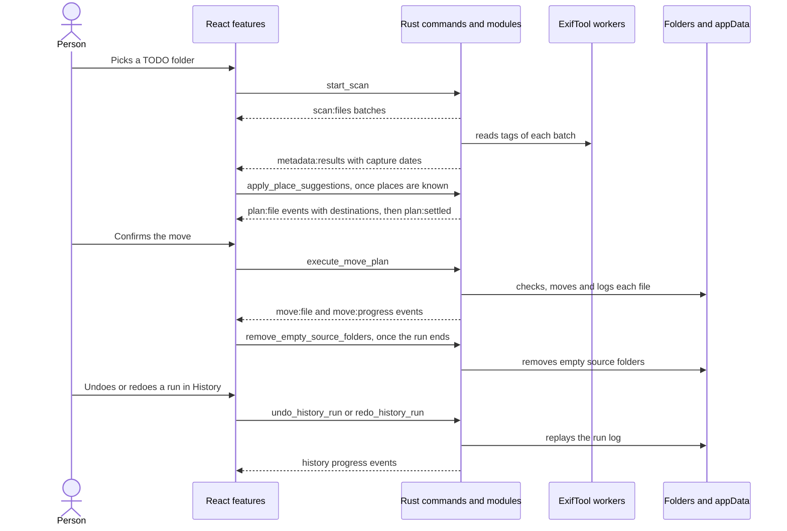
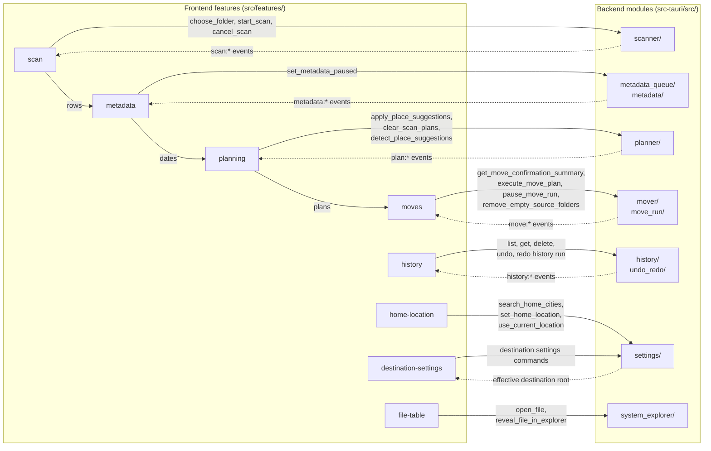

# Architecture

Media Organizer is a Tauri 2 desktop app. The Rust backend owns every filesystem decision: scanning, metadata, planning, moves, history, settings and safety checks. The React frontend renders backend state, queues work and sends confirmed batches.

## Big Picture

## Main Flow

1. The user picks a TODO folder. `features/scan` clears the old folder's rows, metadata, plans and moves, then calls `start_scan`. Events from the replaced scan are dropped until the new one starts.
2. `scanner` walks the folder on the blocking pool and streams `scan:*` events.
3. `scan_metadata` takes each batch of photos and videos right after its `scan:files` event and reads them through the persistent ExifTool workers of `metadata_queue`. It streams `metadata:results` and ends with `metadata:finished`. Both carry the `scan_id` from `scan:started`, so `features/metadata` drops dates of a replaced scan. The same request reads `GPSLatitude#`, `GPSLongitude#` and `GPSCoordinates#`, so each `MetadataResult` carries `gps` in signed decimal degrees, or `null`.
4. `scan_session` plans each file once its date is read and the place folders are known. `apply_place_suggestions` tells it the folders the person accepted, see Place Suggestions. `planner` streams `plan:*` events with destination previews and the `scan_id`. One lock orders every planning pass of a scan, so `features/planning` mirrors the events as they land. Every plan of a scan shares one set of reserved names, so two files planned in different passes don't get the same destination.
5. After the user confirms, `features/moves` sends ready plans to `execute_move_plan`. `move_run` checks, moves and records each file and streams `move:*` events. When the last batch is done, `features/moves` calls `remove_empty_source_folders` once.
6. `history` keeps a JSONL log per run in appData. `undo_redo` replays a run in either direction and streams `history:*` events.

## How Frontend And Backend Talk

Each frontend feature calls its own commands through `lib/api/`. The backend answers with events, or with the command result for metadata and settings.

- **Solid arrows** are commands, sent with `invokeCommand` in `lib/api/`.
- **Dotted arrows** are what comes back. Events arrive through `listenAll` and `useBackendEvents`. Move events and metadata results go through `lib/useBufferedFlush.ts`. Scan rows and plans have their own buffers. A large folder costs a few renders a second instead of one per file.
- **Arrows inside the frontend** pass data between features through `app/useAppSession.ts`.
- **Ids, not records** the backend keeps each scan's records and dates in `scan_session`, so commands get file ids or plans. A folder of 100,000 files doesn't cross IPC again on every plan or move.
- **Startup** `app/useBackendBootstrap.ts` calls `health_check` and `get_destination_settings`.

## Layering

Each layer may depend only on the layers below it.

| Layer         | Backend (`src-tauri/src`)                                         | Frontend (`src`)                                      |
| ------------- | ----------------------------------------------------------------- | ----------------------------------------------------- |
| Entry         | `main.rs` registers state and commands                            | `main.tsx`, `App.tsx` lays out features               |
| Orchestration | `commands/` thin async handlers                                   | `app/` wires features together                        |
| Features      | domain modules listed below                                       | `features/<name>/`, used only through `index.ts`      |
| Shared        | `models/`, `events.rs`, `path_safety.rs`, `file_ops/`, `safe_fs/` | `lib/api/`, `lib/types/`, `components/design-system/` |

- **Tauri stays at the edge.** Only `main.rs`, `commands/` and `events.rs` use `AppHandle`. Domain modules take paths, stores and an `EventSink`.
- **Commands stay thin.** A handler resolves app paths in `commands/app_dirs.rs`, runs filesystem work through `commands/background.rs`, and delegates. Validation and orchestration live in the domain module, as in `move_run::start_move_run` and `undo_redo::prepare_replay`.
- **No blocking on the UI thread.** Commands that touch the filesystem are `async`. Long jobs use `spawn_job` and report through events. Folder pickers use the callback dialog.
- **Features talk through indexes.** ESLint rejects deep imports into another feature, feature imports of `app/`, and `lib/` or design-system imports of features.
- **Errors cross the boundary as `String`.** Internal enums such as `WorkerError` and `OperationOutcome` exist only where code branches on the error kind.

## Backend Modules

- `commands/`: one file per command group, plus `app_dirs`, `background` and `folder_dialog` helpers.
- `models/`: serde payloads shared with `src/lib/types/`, split by domain and re-exported as `crate::models::*`.
- `events.rs`: event names, the `EventSink` trait and typed emit helpers. Tests use `test_support::events::RecordingSink`.
- `scanner/`: recursive walk, media classification, `Processed` skipping and the `ActiveScan` cancel handle. A file with no usable extension, such as `name(IMG_1.jpg)`, is identified by its first bytes and gets the matching extension when it moves.
- `metadata/`: ExifTool sidecar lookup, worker lifecycle, JSON parsing, capture-date selection and GPS parsing.
- `scan_session/`: the records and dates of the scan on screen, in `AppState::current_scan`. It also owns the scan's plans: it plans read files, applies place folders, swaps placed files and clears plans for a new destination. `detect_place_suggestions`, `get_move_confirmation_summary` and `execute_move_plan` take the `scan_id` and file ids, and look the files and plans up there. A command for a replaced scan fails.
- `scan_metadata/`: reader threads that read the dates of a running scan's photos and videos, pause with `set_metadata_paused`, and stop with the scan.
- `metadata_queue/`: bounded batch queue over the worker pool, with env-configurable limits. The workers run at low priority on half the cores by default, so a large read leaves the desktop responsive.
- `planner/`: dated destination paths, original-name filenames and conflict suffixes. Planning is a dry run. With `rename_in_place` on, `DestinationLayout::SameFolder` keeps each file in its folder, except files in an accepted place folder. A file that already has its planned name gets `already_named` and stays out of the move.
- `mover/`: move preparation, root safety checks, conflict recheck, rename with verified copy fallback, and the confirmation summary.
- `move_run/`: one confirmed batch from start to finish: history run, per-file progress and results. `remove_empty_source_folders` cleans the source after the whole run.
- `history/`: `HistoryStore` over run logs and the bounded index, crash recovery, undo/redo candidates, the `RunLease` that lets one job work on a run, and the listing cache.
- `undo_redo/`: `ReplayDirection` eligibility, per-operation checks and the `ReplayJob` that logs each step.
- `settings/`: `SettingsStore` and effective destination root resolution. `rename_in_place` wins over the custom root and the Processed folder, and resolves to the selected folder. `place_folder_root` resolves the root as if `rename_in_place` were off: place folders go there in both modes. `group_by_place` (default on) turns place folders on. The toolbar treats `rename_in_place` as turning it off.
- `home_location/`: reads the saved home for place suggestions, finds it on the device, learns it from large scans, and finds cities by name. `device/` holds the `DeviceLocator` trait. `SystemLocator` asks CoreLocation on macOS and reads the time zone with `iana-time-zone`. Tests use a fake locator.
- `placements/`: the registry of trip and outing folders that runs filled. Detection matches new suggestions against it. See Continued Place Folders.
- `safe_fs/`: the only code that renames, links, copies into or deletes files. See File Safety Guarantees.
- `geo/`: offline reverse geocoding. See Offline Places.
- `trips/`: groups files into trip and outing suggestions. See Place Suggestions.
- `picked_folders.rs`: folders the user chose in the native picker this session.
- `filename/`, `system_explorer/`, `path_safety.rs`, `file_ops/`: focused helpers named after what they decide.

## Offline Places

`geo/` turns a GPS point into a place name without a network call.

- **Data** is `src-tauri/assets/geodata.tsv.gz`, a GeoNames extract (CC BY 4.0) built by `scripts/geodata/build_geodata.py`. It holds cities with 1000 people or more and points of interest such as gardens, museums, waterfalls and national parks. Small kinds need an English Wikipedia link to stay in.
- **Park outlines** are `src-tauri/assets/parks.tsv.gz`, built by `scripts/geodata/build_parks.py` from Overture Maps (OpenStreetMap, ODbL). It holds national parks, state parks and wilderness areas of 1 km² or more, simplified to about 50 m. Names in other scripts are spelled in Latin letters, apart from Chinese, Japanese and Korean, which stay as written. `geo/parks` puts them in one-degree cells and splits each ring into runs of 64 edges with their own box, so a point test skips most edges. The place suggestions dialog credits GeoNames and OpenStreetMap.
- **Loading** happens once, on the first lookup, through a `LazyLock`. Call lookups from a background thread.
- **Search** uses a one-degree grid, so a lookup scans only nearby cells.
- **City names** for `search_home_cities` load into a separate list on the first search. Matches ignore case and accents, and `ue` matches `u`, so "Zür" finds "Zuerich". Names that start with the text come first, then names that contain it. Bigger cities rank higher, up to 10 results.
- **Radii** stand in for outlines where GeoNames has points only. `geo/radius.rs` gives each kind a radius, and a city a reach that grows with population: San Francisco covers about 18 km.
- **One search** `geo::resolve` gathers the places within 50 km once and answers every lookup below from them.
- **Place names** name trip folders. A park outline or a city wins first, in `geo/area.rs`. Within the reach of a city of 50,000 people or more, only a park of 100 km² or more beats the city. Elsewhere a point inside a park, or within 5 km of a 100 km² park, takes the park's name. So Katoomba names Blue Mountains National Park, Garie Beach names Royal National Park, and Bondi stays Sydney. Next comes the most nested point of interest, then the nearest city within 50 km, then any place within 150 km.
- **Outing names** come from `geo/notable.rs`. An attraction such as a zoo, museum or garden wins, then the park outline around the point, then any other point of interest.
- **Countries** come from the nearest place, so a point near a border can get the neighbour.

## Place Suggestions

`detect_place_suggestions(selected_path, files, metadata_results)` returns `PlaceDetection`: `suggestions`, `file_places` and `status`. `home_location::detect_place_suggestions` reads the saved home, then `trips::PlaceScan` groups the files on the blocking pool, with no filesystem calls. Each GPS point is geocoded once, and points 0.001 degrees apart share a lookup. The thresholds sit in `trips/thresholds.rs`.

- **Home** is the saved home when settings hold one. The scan files only replace a `time_zone` home.
- **Source ranking** `manual` beats `device`, `device` beats `learned`, `learned` beats `time_zone`. `settings::offer_home_location` saves a found home only over a weaker source. Use current location and picking a city replace any home.
- **Device home** on start, with no home or a `time_zone` home saved, `home::find_home_on_start` runs one background job. On macOS it asks for when-in-use location access and waits up to 10 s for one fix, on that thread's run loop. The nearest city becomes home as `device`. Without a fix (denied, off, timed out, or not macOS) the system time zone names home as `time_zone`: `Australia/Sydney` gives the biggest city starting with `Sydney` in the zone's country from `/usr/share/zoneinfo/zone.tab`. Detection doesn't wait for this job.
- **Learned home** with no saved home or a `time_zone` home, the scan picks the nearest city with the most distinct geotagged days. With 60 days and 30% of all geotagged days, settings save it as `learned`.
- **One-off home** a scan under 60 days still uses that city for itself when it has 14 days and 30% of the days. It saves nothing, and a `time_zone` home wins over it, since a small scan is often one trip. Below that, home is unknown.
- **Trips** need a known home. A trip is a run of 5 or more files over 100 km from home, with at most 3 days between them.
- **Country folders** `trips/country_split.rs` splits each trip into one suggestion per country outside home's country, plus one for home's country. A foreign part gets `country` and is titled after it. The home part keeps a title from its countries. Trip root files go to the country they were shot in, or the trip's main country with no GPS. An outing abroad gets `country` too. With no known home every country is foreign.
- **Trip places** group files by resolved place across the trip. A point of interest with under 5 files falls back to its city. A city with under 5 files falls back to the trip root.
- **Outings** are 5 or more files at one notable place outside trips, merged per year. A city makes no outing.
- **Files with no GPS** join the trip place of a geotagged file within 3 hours, else the trip root. Outside trips they join an outing with a file within 1 hour on the same day.

- **File places** `file_places` maps each geotagged photo or video id to a short label from the same lookups: the matched place, else the city. A country other than home's is added, as in `Louvre, France`. The file table shows it in the Place column.
- **Status** says why nothing was found, checked in this order: `no_gps`, `home_unknown`, `all_near_home` (with the `home` city name), `too_few_geotagged`. It is `found` when there are suggestions.

`PlaceSuggestion` holds `id`, `kind` (`trip` or `outing`), `year`, `title`, `start`, `end`, `file_count`, `places`, `root_file_ids`, `country`, `continues` and `month_folder`. Each `PlaceGroup` holds `name`, `place_kind`, `day_layout`, `start`, `end` and `file_ids`. Dates use the `chosen_date` format.

`apply_place_suggestions` takes the accepted suggestions as `place_suggestions`. `planner::PlaceFolders` maps each file to its folder:

- **Trip place** `<root>/<year>/<title>/<place>/<days>`. Trip files in no place go to `<root>/<year>/<title>/<days>`.
- **Trip abroad** `<root>/<year>/<country>/<place>/<days>`. The planner uses `country` as the folder whatever the title says, so the edit dialog only lets the person rename places.
- **Outing** `<root>/<year>/<place>/<days>`, or `<root>/<year>/<country>/<place>/<days>` abroad.
- **Days** follow the group's date span: no folder for one day, `MM-DD` up to 31 days, `<month>/<day>` past that. The trip root uses the span of the whole trip.
- **Checks** run on every call. Edited names must be one plain folder name, and get the Windows-safe form. A file in two folders is an error. The year comes from `start`. Day layouts come from `start`, `end` and the file dates, so the sent `day_layout` is ignored.
- **Other files** keep `<root>/<year>/<month>/<day>`.
- **Rename in place** renames the other files in their folder. Files in an accepted suggestion still go to their place folder under `place_folder_root`: the custom root, else `<selected>/Processed`. The move run allows that root as a second destination. The history run records it as `place_root_path`, so undo checks and the registry use it too.
- **Plans** carry `placement` (`kind`, `year`, `title`, `place`, `country`, `month_folder`) for files that go to a place folder. The frontend sends it back unchanged with `execute_move_plan`.

`features/place-suggestions` calls `detect_place_suggestions` once per scan and home, 1 s after the last metadata lands, in both destination modes. A new metadata batch only updates the progress count. A reset or a new home drops a late answer.

- **Group by place** is a toolbar checkbox saved as `group_by_place` through `set_group_by_place`. Its tooltip lists the places found, or the reason from `status`, and credits GeoNames and OpenStreetMap. With **Rename only** on it shows unchecked and disabled. Both lock once moves are confirmed.
- **Edit places (N)…** sits next to the box while it is on and detection found places. The dialog renames folders or sends a trip to date folders, with a preview of the folders. Update folders saves the choices by suggestion id and replans the changed files. It moves no file: Move Files does that. A suggestion with no saved choice goes to its place folders as found.
- **Waiting for places** each scan's session plans nothing until the first `apply_place_suggestions`. With the box on, that comes once detection answers, fails, or the scan stops. So no file shows a date folder first, and the status bar says `Checking files` until then.
- **Place column** in the file table reads `file_places` by file id. Photos and videos show a spinner and `Locating...` until the answer lands. Files with no GPS get an empty cell.

Each answer with new suggestions goes to `apply_place_suggestions`. With the box off it gets none. Each plan signature in `scan_session` holds the file's place folder, so only files whose folder changed get planned again. Toggling the box or a new destination calls `clear_scan_plans` and detects again. A new scan starts a new session. After moves are confirmed, a later answer changes no plan.

Place folders are desktop only. The Android app keeps dated folders.

## Continued Place Folders

A person who sorted files by month scans one month folder at a time. A trip from Oct 28 to Nov 2 then shows up in two scans. The registry lets the second scan add to the folder the first one filled.

- **Registry** is `<appData>/placements/placed-suggestions.json`, written by `PlacementStore`. Each record holds `root`, `kind`, `year`, `title`, `start`, `end`, `places` (`name`, `start`, `end`, `files`), `root_files`, `country` and `month_folder`. A file is `relative_path` from the root plus `chosen_date`. A missing file loads as an empty registry.
- **Recording** happens when a move run ends. Files that moved or copied with a `placement` join the record of their folder. Skipped and failed files stay out. A file moved inside the root replaces its old entry.
- **Undo** drops the undone files, and records left empty. A placed file that goes back to its old place folder is recorded there again. Redo doesn't add them back.
- **Matching** `detect_place_suggestions` loads the records under the place folder root and drops records whose folder is gone, with one check per record. A suggestion continues the closest record of the same kind and `country` at most 3 days apart (`TRIP_MAX_GAP`). An outing also needs the same place name. Records from before `country` count as home's country.
- **Continuation** sets `continues` (`title`, `year`, `start`, `end` and the placed `places`). The suggestion takes the record's title, year and place folder names. The person can rename it in the edit dialog, which drops `continues` and starts a new folder.
- **Day layouts** of a continued place span its placed files and the new ones. The trip root spans the whole record too.
- **Placed moves** `apply_place_suggestions` runs `planner::plan_continued_moves` and sends `plan:placed` with `PlacedMove[]` (`record`, `metadata`, `plan`) for placed files whose day folder changes, and the ids of the ones the last folders moved. A file no longer on disk is left out. `features/planning` adds them to the rows, so the table, the confirmation and the run treat them like scanned files. Normal planning skips them.
- **Emptied day folders** a run removes the folders placed files moved out of once they are empty, walking up parent by parent. It stops below the place folder, or the trip or outing folder for files in no place (`safe_fs::remove_empty_parents`).

## Month Folder Placement

A library already sorted by date has `<root>/<year>/<month>/<day>` folders, as the dated layout writes them. A person can open one month folder and group it by place.

- **Month scans** `placements::MonthFolder` sees a selected folder at `<year>/<month>` or `<year>/<month>/<day>` under the place folder root. The month keeps its name on disk, so `5` and `05` both work. Any other folder keeps the year level rules above.
- **At home** a suggestion with no `country` gets `month_folder` and goes to `<root>/<year>/<month>/<trip or place>`. It continues only records of the same month, by the usual rules.
- **Abroad** a suggestion joins every record of its root, year and `country`, whatever the gap. With none, or only records of this month, it stays in the month: `<root>/<year>/<month>/<country>/<place>`. When another month, or the year level, holds that country, `month_folder` is `None` and everything goes to `<root>/<year>/<country>/<place>`.
- **Country wide continuation** sets `continues.country_wide`, titled after the country. `places` merges the placed places of the same name, and `lifted` counts the files of each month folder that moves up. The review shows `Moves 2026/5/USA into 2026/USA (34 files)`. Renaming a place keeps the continuation.
- **Lifted files** `planner::plan_continued_moves` plans every file of those records into the year level folder of the same trip or outing and place. A place the new scan also has takes its day layout, so a span over 31 days gets `<month>/<day>`. Others follow their placed span. The run records them at year level and drops the emptied month records. Emptied folders go up to the month folder, so `2026/5/USA` goes too.
- **Registry** records keep `month_folder`, `None` for year level. Records from before it load as year level.
- **Rescans** of a folder that holds placed files keep them where they are. Each planning pass looks up its files under the place folder root in the registry (`planner::placed_files_under`). A batch with no file under the root skips the registry. A placed file in no accepted suggestion stays in its folder in both modes, keeps its `placement`, and only gets the planned name. Detection takes placed files out of the suggestions first, so a suggestion of placed files only is dropped, and new files beside them continue the placed folder.
- **Undo** puts each undone file that came from a place folder of the same record back in that record, at its level or in the month folder it was lifted from. Other undone files are dropped.

## Frontend Modules

- `app/useAppSession.ts`: composes the scan, metadata, planning, moves, history and destination hooks.
- `app/useBackendBootstrap.ts`: loads health and settings at startup.
- `app/useDestinationChange.ts`: applies a destination change and replans before any move starts.
- `features/`: `scan`, `metadata`, `planning`, `place-suggestions`, `moves`, `history`, `file-table`, `status-bar`, `destination-settings`, `home-location`, `toolbar`.
- `features/home-location`: the Home section in the settings menu. It shows where home came from, such as `from your location`. It searches cities 200 ms after typing stops. Use current location calls `use_current_location` and shows `Locating…` until the fix or the error. Opening the menu reloads settings, so a learned or device home shows up. A new home makes `features/place-suggestions` detect again.
- `lib/api/`: typed command wrappers, `listenAll` event subscriptions and `useBackendEvents`.
- `lib/types/`: re-exports the TypeScript payloads ts-rs generates from `src-tauri/src/models/` into `lib/types/generated/`.

The frontend doesn't decide filesystem outcomes. It renders streamed events, derives tallies from them and prevents duplicate dispatch by file id.

## Android App

`android/` is a separate Kotlin app that moves the phone gallery into dated folders on the device. It shares no code with the desktop app. Its user flow and code diagrams are in `android/README.md`.

- **`organize/`** copies the scanner, planner, filename and date rules with no Android imports, so JVM tests cover it.
- **`folders/`** lets the person pick the gallery and Move to folders, and keeps both between launches.
- **`metadata/`** reads the same tags with `ExifInterface` and `MediaMetadataRetriever` and prints them in ExifTool's date format.
- **Moves** plan and move one file at a time with `Files.move` without replace, after all files access is granted.
- **No history.** A run keeps counters and the newest log lines in memory.

## Data And Persistence

- **Placed suggestions** are `<appData>/placements/placed-suggestions.json`, written by `PlacementStore`. See Continued Place Folders.
- **Settings** are `<appData>/settings/destination-settings.json`, written by `SettingsStore`. `home` holds `name`, `country`, `latitude`, `longitude` and `source` (`manual`, `device`, `learned` or `time_zone`). Files saved before `home` existed load with no home.
- **History** is `<appData>/history/runs/*.jsonl` plus `index.json`, written by `HistoryStore`.
- **App log** goes to stdout and the OS log folder through `tauri-plugin-log`, set up in `main.rs`. The emit helpers in `events.rs` and `events/log_lines.rs` write one line per event. Per-file scan and plan lines are `debug` and stay out of the default `info` level.
- **Writes** to settings, placed suggestions and the history index take a process lock and replace the file through a temp file.
- **ExifTool** ships as a sidecar under `src-tauri/binaries/`. On macOS the sidecar is a launcher that runs the Perl script with the system Perl. Details are in `docs/exiftool-sidecar.md`.
- **Specs** with feature intent and acceptance criteria live in `specs/`.

## File Safety Guarantees

When a step can't be done safely, the source stays in place and the step reports an error.

- **Only `safe_fs` mutates files.** `src-tauri/clippy.toml` rejects `fs::rename`, `copy`, `hard_link`, `remove_*`, `write`, `File::create`, `set_len` and `OpenOptions::create`/`truncate` everywhere else. `create_dir_all` only adds folders.
- **No overwrite.** `move_file_no_replace` uses an exclusive rename: `renamex_np(RENAME_EXCL)` on macOS, `renameat2(RENAME_NOREPLACE)` on Linux, `MoveFileExW` without `REPLACE_EXISTING` on Windows. Where that's unsupported it hard-links, checks identity, then unlinks the source. A destination that appears after the conflict check fails with `AlreadyExists` and both files stay.
- **Copies keep the source.** Cross-volume moves fall back to `copy_verified_no_replace`: a `create_new` temp file beside the destination, fsync, size and byte check, no-replace publish, final check. A failed copy removes only the temp file this run created, matched by file identity.
- **Deletes need proof.** Undo of a copy deletes it only when a different regular file at the source has the same bytes (`remove_verified_duplicate`). Source cleanup walks the selected folder deepest first and calls only `remove_dir`, which refuses a folder that holds anything. It removes the selected folder too once it is empty, skips links, and skips the destination root with everything inside it (`remove_empty_folders`).
- **Duplicates are kept.** The planner blocks a file whose bytes match a file already at its destination name or a numbered `(n)` variant of it. Neither file is touched.
- **App files stay app files.** Settings and the history index are replaced through a unique `create_new` temp file (`replace_app_file`). Run log appends and deletes need a `.jsonl` file directly in `history/runs` (`history::paths::checked_run_log_path`).
- **Roots.** Moves start only from a folder picked this session (`picked_folders`). Sources must be plain files inside it, or inside the effective root for a placed file that moves to a new day folder. Destinations must sit inside the effective root, checked again right before each move (`mover::safety`, `mover::conflict_recheck`). Replay steps must stay inside the run's recorded folders (`undo_redo::recorded_roots`).
- **Undo and redo** check the recorded size, refuse links and taken paths, and use the same no-replace move and verified copy. A move run or a replay stops moving files once its log can't record a step. One move, replay or delete works on a run at a time (`history::RunLease`).
- **Pause stops between files.** `pause_move_run` cancels the running batch after the file moving now. The files it didn't reach keep no result and stay at the source. The frontend queues them again and calls `set_metadata_paused`, so `scan_metadata` starts no new reads until the person resumes. A paused run doesn't finish, so source cleanup waits for the resume.
- **ExifTool is read-only.** Requests carry only `-charset filename=utf8`, `-json`, read tags, `-execute` and absolute single-line paths (`metadata::argfile_path`).
- **The user confirms.** Moves, undo, redo and history delete all ask first. The webview holds only `core:default` permissions, with no fs or shell plugin.
- **Crashes lose nothing.** An interrupted move leaves the file at the source, at the destination, or under both names of one hard link. An interrupted copy leaves a hidden `.media-organizer-copying-*.tmp` file and the source. History recovery only reads logs.
