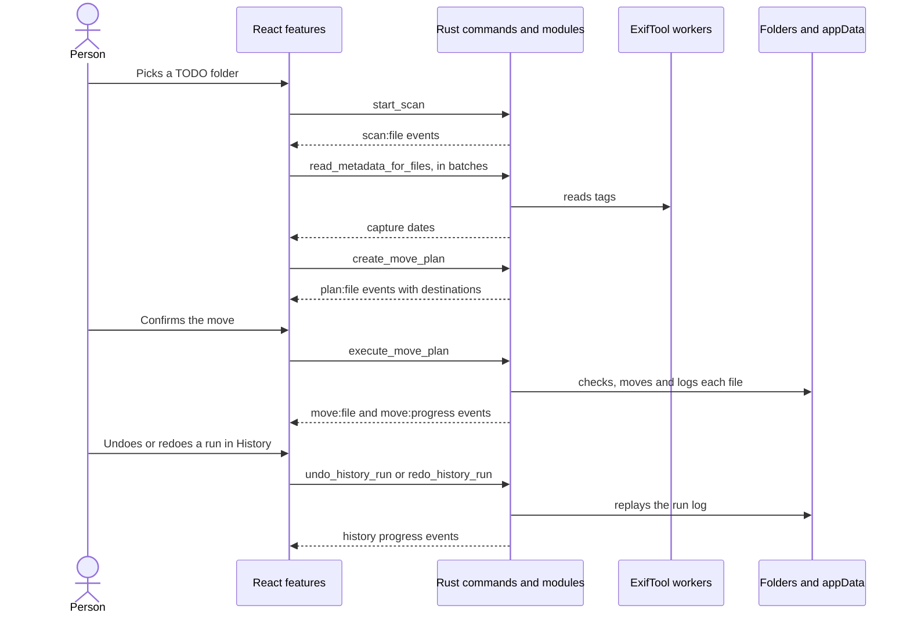

# Architecture

Media Organizer is a Tauri 2 desktop app. The Rust backend owns every filesystem decision: scanning, metadata, planning, moves, history, settings and safety checks. The React frontend renders backend state, queues work and sends confirmed batches.

## Big Picture

## Main Flow

1. The user picks a TODO folder. `features/scan` clears the old folder's rows, metadata, plans and moves, then calls `start_scan`. Events from the replaced scan are dropped until the new one starts.
2. `scanner` walks the folder on the blocking pool and streams `scan:*` events.
3. `features/metadata` batches media rows into `read_metadata_for_files`. `metadata_queue` reads them through persistent ExifTool workers.
4. `features/planning` sends rows with metadata to `create_move_plan`. `planner` streams `plan:*` events with destination previews.
5. After the user confirms, `features/moves` sends ready plans to `execute_move_plan`. `move_run` checks, moves and records each file and streams `move:*` events.
6. `history` keeps a JSONL log per run in appData. `undo_redo` replays a run in either direction and streams `history:*` events.

## Layering

Each layer may depend only on the layers below it.

| Layer         | Backend (`src-tauri/src`)                                         | Frontend (`src`)                                      |
| ------------- | ----------------------------------------------------------------- | ----------------------------------------------------- |
| Entry         | `main.rs` registers state and commands                            | `main.tsx`, `App.tsx` lays out features               |
| Orchestration | `commands/` thin async handlers                                   | `app/` wires features together                        |
| Features      | domain modules listed below                                       | `features/<name>/`, used only through `index.ts`      |
| Shared        | `models/`, `events.rs`, `path_safety.rs`, `file_ops/`, `safe_fs/` | `lib/api/`, `lib/types/`, `components/design-system/` |

- **Tauri stays at the edge.** Only `main.rs`, `commands/` and `events.rs` use `AppHandle`. Domain modules take paths, stores and an `EventSink`.
- **Commands stay thin.** A handler resolves app paths in `commands/app_dirs.rs`, runs filesystem work through `commands/background.rs`, and delegates. Validation and orchestration live in the domain module, as in `move_run::start_move_run` and `undo_redo::prepare_replay`.
- **No blocking on the UI thread.** Commands that touch the filesystem are `async`. Long jobs use `spawn_job` and report through events. Folder pickers use the callback dialog.
- **Features talk through indexes.** ESLint rejects deep imports into another feature, feature imports of `app/`, and `lib/` or design-system imports of features.
- **Errors cross the boundary as `String`.** Internal enums such as `WorkerError` and `OperationOutcome` exist only where code branches on the error kind.

## Backend Modules

- `commands/`: one file per command group, plus `app_dirs`, `background` and `folder_dialog` helpers.
- `models/`: serde payloads shared with `src/lib/types/`, split by domain and re-exported as `crate::models::*`.
- `events.rs`: event names, the `EventSink` trait and typed emit helpers. Tests use `test_support::events::RecordingSink`.
- `scanner/`: recursive walk, media classification, `Processed` skipping and the `ActiveScan` cancel handle.
- `metadata/`: ExifTool sidecar lookup, worker lifecycle, JSON parsing and capture-date selection.
- `metadata_queue/`: bounded batch queue over the worker pool, with env-configurable limits.
- `planner/`: dated destination paths, original-name filenames and conflict suffixes. Planning is a dry run.
- `mover/`: move preparation, root safety checks, conflict recheck, rename with verified copy fallback, and the confirmation summary.
- `move_run/`: one confirmed batch from start to finish: history run, per-file progress, results and source folder cleanup.
- `history/`: `HistoryStore` over run logs and the bounded index, crash recovery, undo/redo candidates, the `RunLease` that lets one job work on a run, and the listing cache.
- `undo_redo/`: `ReplayDirection` eligibility, per-operation checks and the `ReplayJob` that logs each step.
- `settings/`: `SettingsStore` and effective destination root resolution.
- `safe_fs/`: the only code that renames, links, copies into or deletes files. See File Safety Guarantees.
- `picked_folders.rs`: folders the user chose in the native picker this session.
- `filename/`, `system_explorer/`, `path_safety.rs`, `file_ops/`: focused helpers named after what they decide.

## Frontend Modules

- `app/useAppSession.ts`: composes the scan, metadata, planning, moves, history and destination hooks.
- `app/useBackendBootstrap.ts`: loads health, processing limits and settings at startup.
- `app/useDestinationChange.ts`: applies a destination change and replans before any move starts.
- `features/`: `scan`, `metadata`, `planning`, `moves`, `history`, `file-table`, `status-bar`, `destination-settings`, `toolbar`.
- `lib/api/`: typed command wrappers, `listenAll` event subscriptions and `useBackendEvents`.
- `lib/types/`: TypeScript copies of the Rust payloads.

The frontend doesn't decide filesystem outcomes. It renders streamed events, derives tallies from them and prevents duplicate dispatch by file id.

## Android App

`android/` is a separate Kotlin app that sorts the phone gallery on the device. It shares no code with the desktop app. Its user flow and code diagrams are in `android/README.md`.

- **`organize/`** copies the scanner, planner, filename and date rules with no Android imports, so JVM tests cover it.
- **`folders/`** lets the person pick the gallery and Move to folders, and keeps both between launches.
- **`metadata/`** reads the same tags with `ExifInterface` and `MediaMetadataRetriever` and prints them in ExifTool's date format.
- **Moves** plan and move one file at a time with `Files.move` without replace, after all files access is granted.
- **No history.** A run keeps counters and the newest log lines in memory.

## Data And Persistence

- **Settings** are `<appData>/settings/destination-settings.json`, written by `SettingsStore`.
- **History** is `<appData>/history/runs/*.jsonl` plus `index.json`, written by `HistoryStore`.
- **Writes** to settings and the history index take a process lock and replace the file through a temp file.
- **ExifTool** ships as a sidecar under `src-tauri/binaries/`. On macOS the sidecar is a launcher that runs the Perl script with the system Perl. Details are in `docs/exiftool-sidecar.md`.
- **Specs** with feature intent and acceptance criteria live in `specs/`.

## File Safety Guarantees

When a step can't be done safely, the source stays in place and the step reports an error.

- **Only `safe_fs` mutates files.** `src-tauri/clippy.toml` rejects `fs::rename`, `copy`, `hard_link`, `remove_*`, `write`, `File::create`, `set_len` and `OpenOptions::create`/`truncate` everywhere else. `create_dir_all` only adds folders.
- **No overwrite.** `move_file_no_replace` uses an exclusive rename: `renamex_np(RENAME_EXCL)` on macOS, `renameat2(RENAME_NOREPLACE)` on Linux, `MoveFileExW` without `REPLACE_EXISTING` on Windows. Where that's unsupported it hard-links, checks identity, then unlinks the source. A destination that appears after the conflict check fails with `AlreadyExists` and both files stay.
- **Copies keep the source.** Cross-volume moves fall back to `copy_verified_no_replace`: a `create_new` temp file beside the destination, fsync, size and byte check, no-replace publish, final check. A failed copy removes only the temp file this run created, matched by file identity.
- **Deletes need proof.** Undo of a copy deletes it only when a different regular file at the source has the same bytes (`remove_verified_duplicate`). Source cleanup removes real, empty folders strictly inside the real selected root with `remove_dir`, never the root and never through a link (`remove_empty_dir_within`).
- **Duplicates are kept.** The planner blocks a file whose bytes match a file already at its destination name or a numbered `(n)` variant of it. Neither file is touched.
- **App files stay app files.** Settings and the history index are replaced through a unique `create_new` temp file (`replace_app_file`). Run log appends and deletes need a `.jsonl` file directly in `history/runs` (`history::paths::checked_run_log_path`).
- **Roots.** Moves start only from a folder picked this session (`picked_folders`). Sources must be plain files inside it and destinations inside the effective root, checked again right before each move (`mover::safety`, `mover::conflict_recheck`). Replay steps must stay inside the run's recorded folders (`undo_redo::recorded_roots`).
- **Undo and redo** check the recorded size, refuse links and taken paths, and use the same no-replace move and verified copy. A move run or a replay stops moving files once its log can't record a step. One move, replay or delete works on a run at a time (`history::RunLease`).
- **ExifTool is read-only.** Requests carry only `-charset filename=utf8`, `-json`, read tags, `-execute` and absolute single-line paths (`metadata::argfile_path`).
- **The user confirms.** Moves, undo, redo and history delete all ask first. The webview holds only `core:default` permissions, with no fs or shell plugin.
- **Crashes lose nothing.** An interrupted move leaves the file at the source, at the destination, or under both names of one hard link. An interrupted copy leaves a hidden `.media-organizer-copying-*.tmp` file and the source. History recovery only reads logs.
