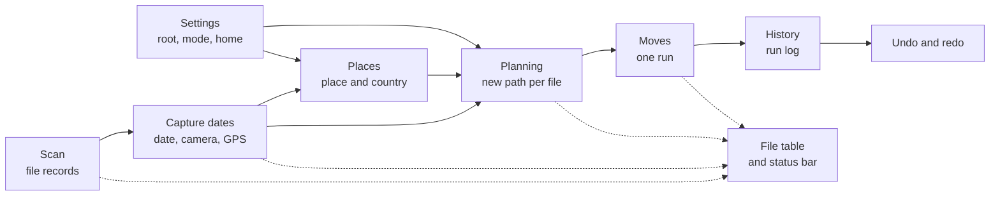

# Features

Each page explains one feature: what the person sees, the user flow, what happens inside, and where the code is. [overview.md](../overview.md) has the whole app on one page.

| Feature                                   | What it does                                                     |
| ----------------------------------------- | ---------------------------------------------------------------- |
| [Scan](./scan.md)                         | Lists every file of the picked folder as it walks it             |
| [Capture dates](./capture-dates.md)       | Reads date, camera and GPS of each photo and video with ExifTool |
| [Places](../places.md)                    | Turns GPS into a place folder, offline                           |
| [Planning](./planning.md)                 | Works out the new folder and name of each file                   |
| [Moves](./moves.md)                       | Moves the confirmed files, with pause, resume and cleanup        |
| [History, undo and redo](./history.md)    | Logs each run and replays it in either direction                 |
| [Settings](./settings.md)                 | Destination root, Rename only, Group by place and Home           |
| [File table](./file-table.md)             | Rows, statuses, filters, the place map and the status bar        |
| [Updates and logs](./updates-and-logs.md) | Self update on start and where the app writes its log            |

## How the features hand work to each other

- **Scan** feeds records to capture dates as each batch lands, so reading starts before the walk ends.
- **Planning** waits for the date and, with Group by place on, the places.
- **Moves** can start while the scan still runs. The run takes files as their plans become final.
- **The file table** shows every step on the same row, keyed by file id.
