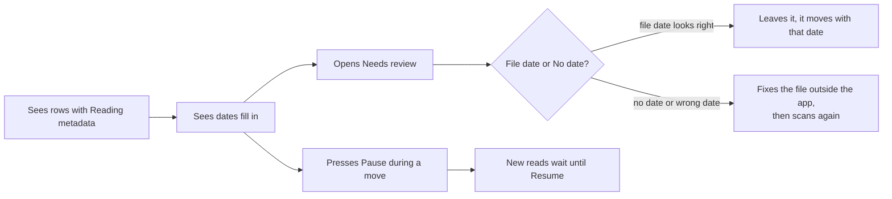
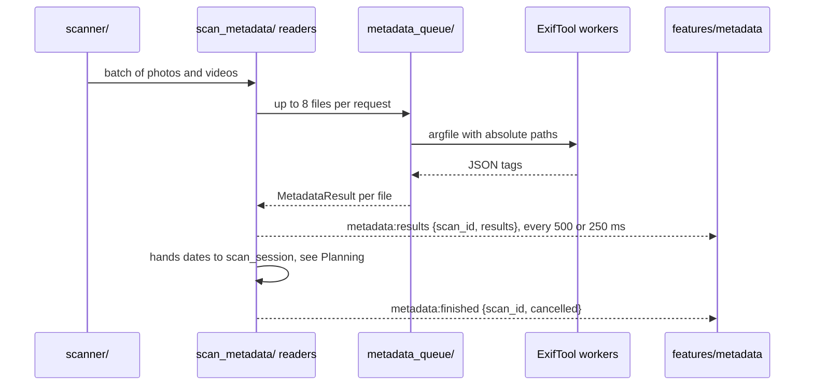
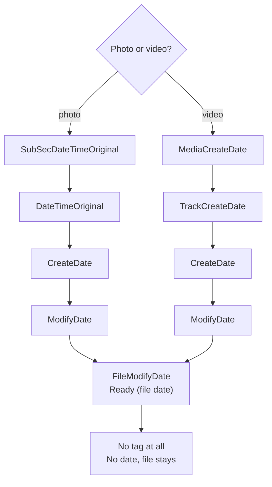

# Capture dates

The app reads when each photo and video was taken, which camera took it and where. It uses ExifTool, which ships inside the app. Reads start with the first scan batch, so dates fill in while the folder is still being walked.

## What the person sees

- **Date column** fills in row by row. The row says `Reading metadata` with a spinner until then.
- **Notes column** names where the date came from, such as `Photo capture time` or `Video recording time`.
- **`Ready (file date)`** the file has no capture date, so the app uses the date the file last changed. The row sits under Needs review.
- **`No date`** the file has no date at all. It stays where it is.
- **`Can't read metadata`** ExifTool failed on the file. The row sits under Errors.
- **Status bar** shows a `Metadata read` tally while reads run.

## User flow

## What happens inside

- **Workers** are long-lived ExifTool processes. The pool uses half the CPU cores, from 1 to 8.
- **Low priority** workers run below normal OS priority, so a big read leaves the desktop responsive.
- **Bounded queue** holds 256 files by default. Files past that get the error `Metadata queue is full` instead of a wait.
- **Timeout** a read that takes over 20 s fails. The worker restarts once and tries again.
- **Pause** `set_metadata_paused(true)` holds new reads. Reads already running finish.
- **Cancel** a new scan or Stop Scan wakes paused readers within 200 ms and ends them.

Environment variables change the limits:

| Variable                                  | Default        | Range          |
| ----------------------------------------- | -------------- | -------------- |
| `MEDIA_ORGANIZER_METADATA_CONCURRENCY`    | half the cores | 1 to 8         |
| `MEDIA_ORGANIZER_METADATA_QUEUE_CAPACITY` | 256            | up to 4096     |
| `MEDIA_ORGANIZER_METADATA_TIMEOUT_MS`     | 20000          | 1000 to 120000 |

## How the date is chosen

- **First tag wins** the app takes the first tag in the list that holds a date.
- **Time zones** a date with a zone turns into local time. A date with no zone counts as local wall time.
- **Format** every date reaches the frontend as `YYYY-MM-DD HH:MM:SS`.
- **Bad values** a tag that holds a date the app can't parse gives `Can't read metadata`.
- **File names** don't count. A date in the name such as `IMG_20240101` is ignored.

## Camera and GPS

- **Camera** the first of `Model`, `AndroidModel`, `SamsungModel`, `DeviceModelName`, `CameraModelName`, `Make` and `AndroidMake`. It ends the new file name: `- Pixel 7`.
- **GPS** comes from `GPSLatitude` and `GPSLongitude`, or `GPSCoordinates` in videos. Values out of range and `0, 0` are dropped.
- **Places** the GPS point goes to [places.md](../places.md) rules once the dates of the scan are read.

## Safety

ExifTool only reads. Each request holds `-charset filename=utf8`, `-json`, the tags to read, `-execute` and absolute single-line paths. `metadata/argfile_path.rs` rejects any other path.

## Code

| Side     | Files                                                                |
| -------- | -------------------------------------------------------------------- |
| Frontend | `src/features/metadata/`, `src/lib/api/metadata.ts`                  |
| Commands | `set_metadata_paused` in `src-tauri/src/commands/scan.rs`            |
| Backend  | `src-tauri/src/scan_metadata/`, `metadata_queue/`, `metadata/`       |
| Payloads | `src-tauri/src/models/metadata.rs`, `models/gps.rs`                  |
| Sidecar  | `src-tauri/binaries/`, [exiftool-sidecar.md](../exiftool-sidecar.md) |
