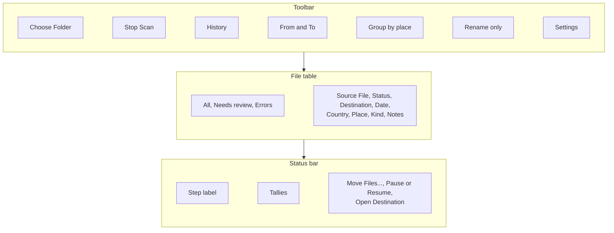
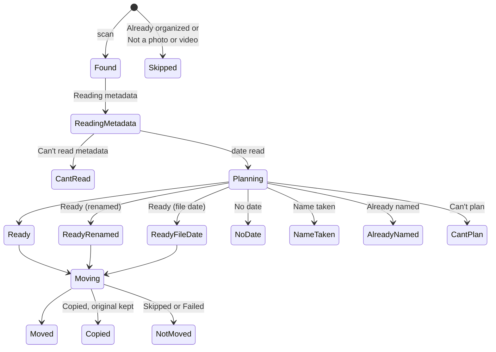
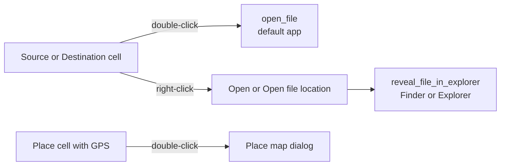

# File table and status bar

The main window is one table of files with a toolbar on top and a status bar below. Each row follows one file from scan to move. The table shows what the backend reports and works out no paths of its own.

## Screen layout

## Columns

| Column      | Shows                                                          |
| ----------- | -------------------------------------------------------------- |
| Source File | Path inside the picked folder                                  |
| Status      | Where the file is in the pipeline, see the diagram below       |
| Destination | New path inside the destination root, or `Planning...`         |
| Date        | Capture date from [capture dates](./capture-dates.md)          |
| Country     | Country of the GPS point, or `Locating...` while the app looks |
| Place       | Place of the GPS point. Double-click opens the map             |
| Kind        | `photo`, `video`, `unsupported` or `unknown`                   |
| Notes       | Why a row needs a look, or where the date came from            |

## Row status

## Filters

Each filter shows a count. Problem rows sort to the top: errors first, then review rows, then the rest by name.

| Filter       | Rows                                                                               | Empty text            |
| ------------ | ---------------------------------------------------------------------------------- | --------------------- |
| All          | Every file                                                                         | No files yet.         |
| Needs review | Not a photo or video, No date, Ready (file date), Name taken                       | No files need review. |
| Errors       | Can't read metadata, Can't plan, and files that were Skipped or Failed in the move | No errors.            |

- **Sort** by original name, then path, with numbers in natural order: `IMG_2` before `IMG_10`.
- **Big folders** the table is virtual, so it draws only the rows on screen.
- **Buffered updates** rows, dates, plans and move results land in batches, a few renders a second.

## Row actions

- **Place map** a dialog with an OpenStreetMap map at zoom 15 and a circle on the point. The title is the place name, and the coordinates show with 5 decimals. Leaflet loads only when the dialog opens.
- **Map data** needs a network. Credit: "© OpenStreetMap contributors."
- **Open and reveal** the backend opens the path with the system handler in `system_explorer/`.

## Status bar

The label names the step the person is in:

| Label           | When                                             |
| --------------- | ------------------------------------------------ |
| No files        | No folder picked, or no photo or video found yet |
| Scanning        | The walk is running                              |
| Scan stopped    | The person pressed Stop Scan                     |
| Checking files  | Dates, places or plans are still on their way    |
| Ready to move   | Every check is done and files are ready          |
| Nothing to move | Every check is done and no file is ready         |
| Moving files    | A run is going                                   |
| Paused          | The run is paused                                |
| Done            | The run ended                                    |

- **Tallies** Files, Metadata read, Skipped, Unreadable, Can't plan, Ready, Renamed, Moved, Copied, Not moved and Failed. A tally shows only when it applies.
- **Backend health** shows `Backend: ...` when `health_check` didn't answer ok.

## Code

| Side       | Files                                                                        |
| ---------- | ---------------------------------------------------------------------------- |
| Layout     | `src/App.tsx`, `src/features/toolbar/`                                       |
| Table      | `src/features/file-table/`, `src/components/design-system/`                  |
| Map        | `src/features/place-map/`                                                    |
| Status bar | `src/features/status-bar/`                                                   |
| Commands   | `open_file`, `reveal_file_in_explorer` in `src-tauri/src/commands/system.rs` |
