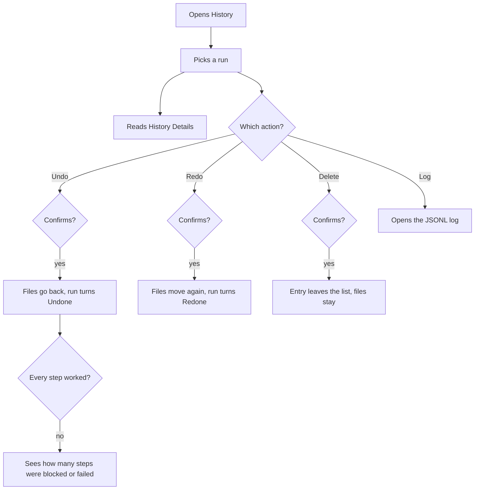
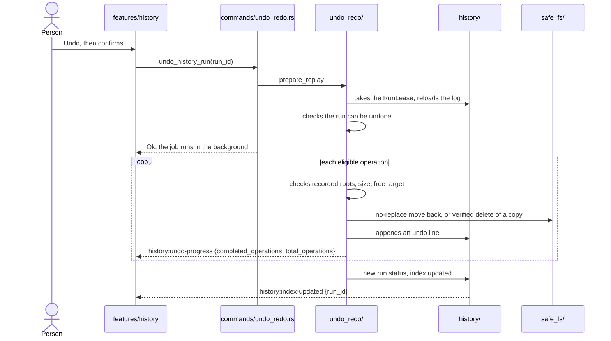
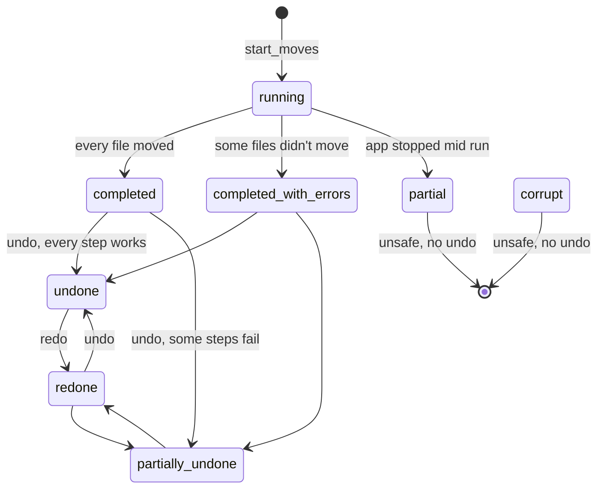
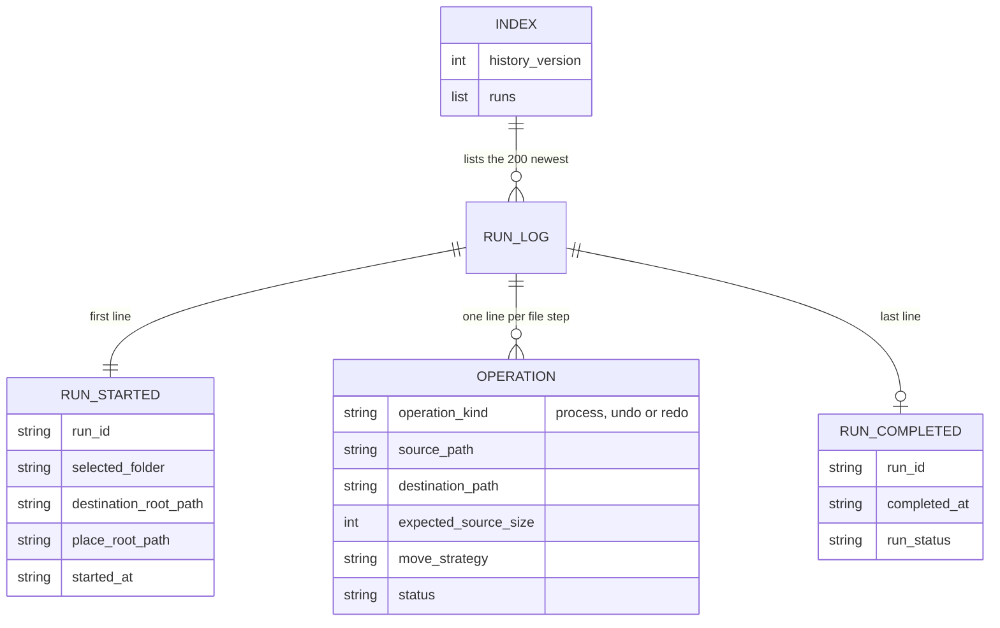

# History, undo and redo

Each move run writes a log, one line per file. History lists the runs. Undo puts the files back, and Redo moves them again. Deleting an entry drops the log and leaves the media files alone.

## What the person sees

- **History** in the toolbar opens a wide pane with **Recent Runs**.
- **Run list** shows When, From, Files, Status, Actions and To for each run.
- **Actions** a run shows **Undo** when it can be undone, else **Redo** when it can be redone. **Delete** and **Log** show on every run.
- **History Details** opens under the list for the picked run. It lists Source, Destination and Status of each file, relative to the run's folders.
- **Unsafe for Undo/Redo** badge marks a run whose log is cut short or broken.
- **Confirm** each action asks first. Undo says "Moved files go back to their original folders. Copies are removed only when the original still holds the same bytes."
- **Problems** a replay with blocked or failed steps ends with "Undo could not be completed: N operation(s) were blocked or failed."

## User flow

## What happens inside

- **Prepare fails early** an unknown, busy, unsafe or ineligible run fails before any file is touched.
- **Recorded roots** each step must stay inside the picked folder, the destination root and the place root the run recorded.
- **Per-step checks** the file must exist with the recorded size. The target must be free. Links are refused.
- **Blocked or failed** a step that fails its checks is `blocked`. A step the disk refuses is `failed`. The replay goes on with the next step.
- **Copies** undo of a copied file deletes the copy only when the original still has the same bytes.
- **Redo** moves or copies the files back to their new paths, without replace.

## Run status

- **Undo allowed** on `completed`, `completed_with_errors` and `redone`.
- **Redo allowed** on `undone` and `partially_undone`.
- **No step worked** the run keeps its old status.
- **`partial` and `corrupt`** come from recovery: a log with no end line, or one that doesn't parse. Both are unsafe for replay.
- **Operation status** each line is `succeeded`, `skipped`, `blocked` or `failed`.

## Storage

- **Run log** a `.jsonl` file in `<appData>/history/runs/`. Each line has a `record_type`: `run_started`, `operation` or `run_completed`.
- **Undo and redo lines** go into the same log, after the moves they replay.
- **Index** `<appData>/history/index.json` keeps the 200 newest runs, newest first, with `undo_available` and `redo_available`.
- **Crash safe** each line is written whole and flushed. A crash can lose at most the last half line.
- **Recovery** listing reads each changed log and rebuilds its summary. A cache skips logs whose size and time didn't change.
- **One job per run** `RunLease` lets one move, replay or delete work on a run at a time.

## Delete

1. The UI asks, then drops the run from the list at once.
2. `delete_history_run` takes the lease and removes the run from `index.json`.
3. It deletes the log only when it sits directly in `history/runs` and ends in `.jsonl`.
4. Media files stay. On an error the UI reloads the list.

## Code

| Side     | Files                                                                |
| -------- | -------------------------------------------------------------------- |
| Frontend | `src/features/history/`, `src/lib/api/history.ts`                    |
| Commands | `src-tauri/src/commands/history.rs`, `commands/undo_redo.rs`         |
| Backend  | `src-tauri/src/history/`, `undo_redo/`                               |
| Payloads | `src-tauri/src/models/history_run.rs`, `models/history_operation.rs` |
| Spec     | `specs/003-history/`                                                 |
