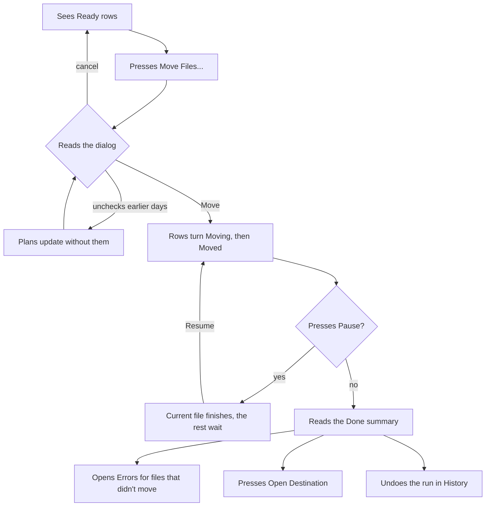
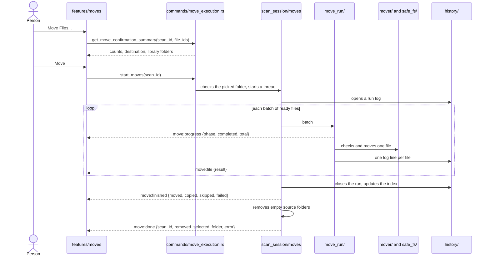
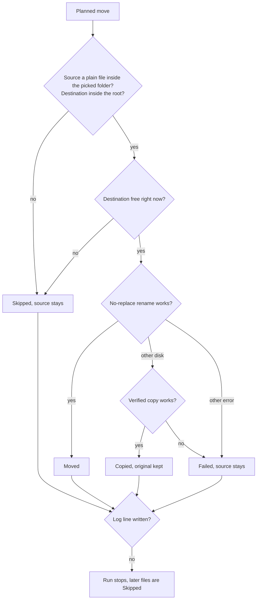
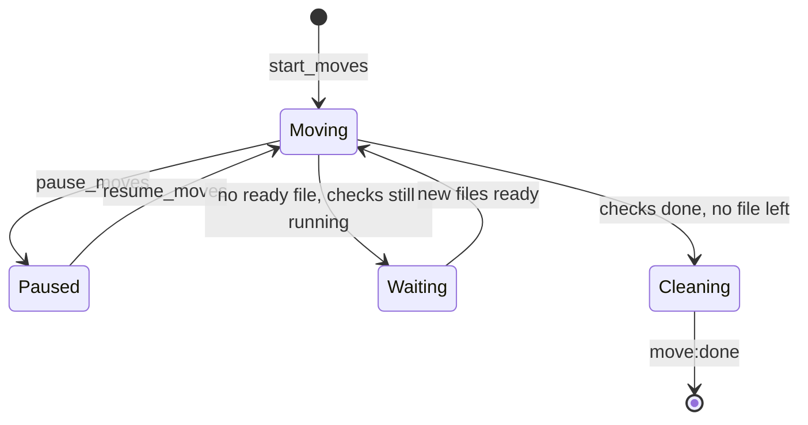

# Moves

Moves take the confirmed files to their planned paths. A run can start while the scan still reads dates. It picks up each file once its plan is final, and ends after the last check.

## What the person sees

- **Move Files...** in the status bar turns on once the scan finds a file. In Rename only mode the dialog says Rename instead of Move.
- **The dialog** asks `Move N files?` and shows the destination. While files are still being checked it asks about all files and says how many are ready now.
- **Warnings** in the dialog count files with no capture date, files that get a number, and files that stay where they are.
- **Earlier days** the dialog lists library folders of the same places that move too, under a checkbox. See [planning.md](./planning.md#earlier-days-of-a-place).
- **Progress** the status bar counts moved files and shows the backend's step, such as `Checking source and destination`.
- **Pause and Resume** replace Move Files during the run. Paused shows "Paused. The file moving now will finish."
- **Done** reads like "Done. Moved 120 files. Copied 3 files and kept the originals. 2 files didn't move. See Errors. You can undo this run in History." Only the parts that apply appear. **Open Destination** shows next to it.

## User flow

## What happens inside

1. **Start** `start_moves` fails unless the scan's folder was picked in the native dialog this session. A second start for the same scan fails too.
2. **Batches** the run thread moves every ready file, then waits for more. Files whose dates or places are still pending join later batches.
3. **End** the run ends once the scan, its reads and its final places are done and no ready file is left.
4. **Cleanup** after the run, the session removes empty folders under the picked folder, deepest first. The destination root is skipped.

## One file

| Result    | Strategy           | What happened                                         |
| --------- | ------------------ | ----------------------------------------------------- |
| `moved`   | `rename`           | The file has its new path                             |
| `copied`  | `copy_keep_source` | A checked copy sits at the new path, the source stays |
| `skipped` | `not_attempted`    | A check failed before the move, the source stays      |
| `failed`  | `rename` or copy   | The move or copy failed, the source stays             |

- **No overwrite** the rename refuses a taken name. A file that appears after the check makes the move fail and both files stay.
- **Verified copy** writes a hidden temp file next to the destination, compares the bytes, then publishes it without replace.
- **History first** a step that can't be logged can't be undone, so the run stops moving.

The full list of checks is in [architecture.md](../architecture.md#file-safety-guarantees).

## Pause and resume

- **Pause** cancels the batch after the file moving now. Files it didn't reach get no result and stay at the source.
- **Reads pause too** the frontend calls `set_metadata_paused(true)`, so ExifTool starts no new reads.
- **No cleanup while paused** a paused run doesn't finish, so source folders stay until Resume.

## Code

| Side     | Files                                                                                             |
| -------- | ------------------------------------------------------------------------------------------------- |
| Frontend | `src/features/moves/`, `src/features/status-bar/`                                                 |
| Commands | `src-tauri/src/commands/move_execution.rs`, `get_move_confirmation_summary` in `commands/plan.rs` |
| Backend  | `src-tauri/src/scan_session/moves/`, `move_run/`, `mover/`, `safe_fs/`                            |
| Payloads | `src-tauri/src/models/move_execution.rs`                                                          |
| Spec     | `specs/002-streaming-queue-processing/`                                                           |
