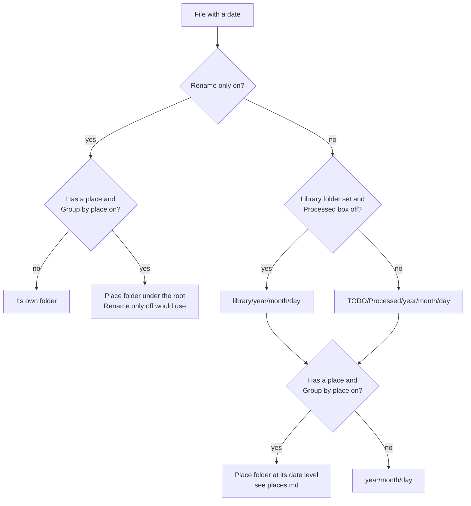
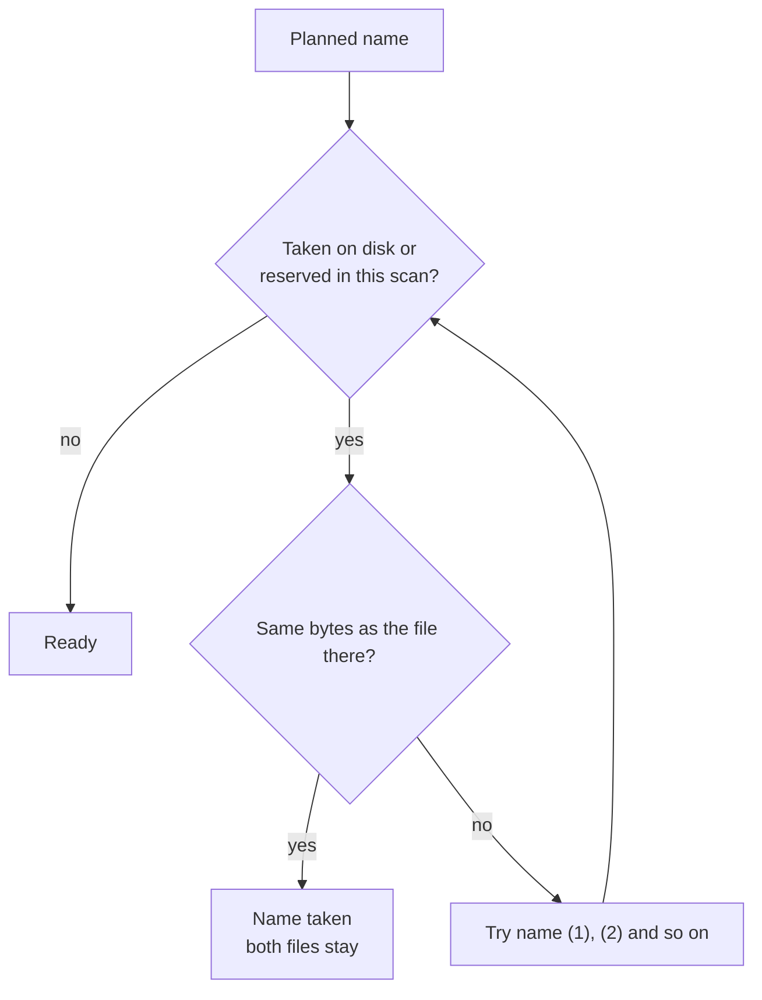
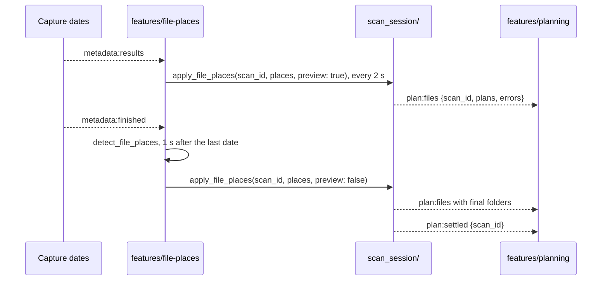

# Planning

Planning works out the new folder and name of each file. It is a dry run: no file moves until the person confirms. The backend plans. The frontend shows the plans as they arrive.

## What the person sees

- **Destination column** shows the new path relative to the destination root. It says `Planning...` with a spinner while the plan is on its way.
- **Status column** shows the plan result, from the table below.
- **Notes column** explains a plan that needs a look, such as "A file with this name is already there. A number is added."
- **Needs review and Errors** filters collect the rows to check before moving.

| Status            | Meaning                                                     | Moves? | Filter       |
| ----------------- | ----------------------------------------------------------- | ------ | ------------ |
| `Ready`           | The file has a new path                                     | yes    | All          |
| `Ready (renamed)` | The name was taken, so the file gets `(1)`, `(2)` and so on | yes    | All          |
| `Already named`   | The file already sits at its planned path                   | no     | All          |
| `No date`         | No capture date, so no path                                 | no     | Needs review |
| `Name taken`      | A file with the same bytes already sits at the destination  | no     | Needs review |
| `Can't plan`      | Planning failed, the note says why                          | no     | Errors       |

## The new name

```text
2026-03-05 10-00-00 Kyoto, Japan (IMG_1234) - Pixel 7.jpg
└─ capture time ──┘ └─ place ─┘  └ original ┘  └ camera ┘
```

- **Capture time** `YYYY-MM-DD HH-MM-SS`, with hyphens so Windows accepts it.
- **Place and country** come after the time when the file has a place. A place named like its country appears once: `Singapore`.
- **Original name** sits in brackets. A file named by the app before keeps its first original: `2024-11-02 13-09-41 (PXL_0042).mp4` stays `PXL_0042`.
- **Camera** follows `-` when ExifTool found one.
- **Windows-safe** `< > : " / \ | ? *` become `_`. Trailing dots and spaces go.
- **Extension** stays as it was, or comes from the file's first bytes when the name had none.

## The new folder



- **Dated folders** `2026/3/5`. Month and day have no leading zero.
- **Place folders** sit at the year, month or day level, by how many days the place spans. The rules and examples are in [places.md](../places.md).
- **Root choice** is in [settings.md](./settings.md).

## Name clashes and duplicates



- **Reservations** every plan of a scan shares one set of reserved names. Two files planned in different passes can't get the same path.
- **Replanning** releases the file's old name first, so a file doesn't clash with itself.
- **Bytes check** covers the base name and every `(n)` name, so a copy of a moved file is caught.

## When plans arrive



1. **No plan before places** the session waits for the first `apply_file_places` before it plans. With Group by place off, that call carries no places.
2. **Previews** show likely folders every 2 s while dates land. A preview plan doesn't move.
3. **Final places** replace the previews. Moves take a file only after this.
4. **Only changes replan** each plan keeps a signature of its place folders. A pass replans only the files whose folder changed.
5. **One lock** orders the passes of a scan, so `plan:files` events arrive in order.

## What makes the app plan again

| Trigger                      | Command                                      | Who calls it                  |
| ---------------------------- | -------------------------------------------- | ----------------------------- |
| New destination root or mode | `clear_scan_plans`, then detect places again | `app/useDestinationChange.ts` |
| Group by place toggled       | `set_group_by_place`, then the same          | `app/useDestinationChange.ts` |
| New home                     | `detect_file_places` again                   | `features/file-places`        |
| Gather earlier days box      | `set_gather_library(scan_id, gather)`        | `features/moves`              |

- **`plan:cleared`** tells the frontend to drop the plans of the scan.
- **Locked after the move starts** the destination and both toggles lock. A new folder unlocks them.

## Earlier days of a place

A place can already have folders for nearby days in the library. Planning counts those days when it picks the level, and adds library moves that bring their files into the new folder. `PlaceFolders::library_moves` plans them. [places.md](../places.md) has the cases.

- **On by default** the move dialog lists each folder that moves, with its file count.
- **Opt out** unchecking **Also move earlier days of these places into the same folder** calls `set_gather_library(scan_id, false)`. The scan's files are planned again without those days.

## Code

| Side     | Files                                                                                    |
| -------- | ---------------------------------------------------------------------------------------- |
| Frontend | `src/features/planning/`, `src/features/file-places/`, `src/app/useDestinationChange.ts` |
| Commands | `src-tauri/src/commands/plan.rs`, `commands/places.rs`                                   |
| Backend  | `src-tauri/src/scan_session/planning/`, `planner/`, `filename/`, `file_places/`          |
| Payloads | `src-tauri/src/models/plan.rs`, `models/places.rs`                                       |
