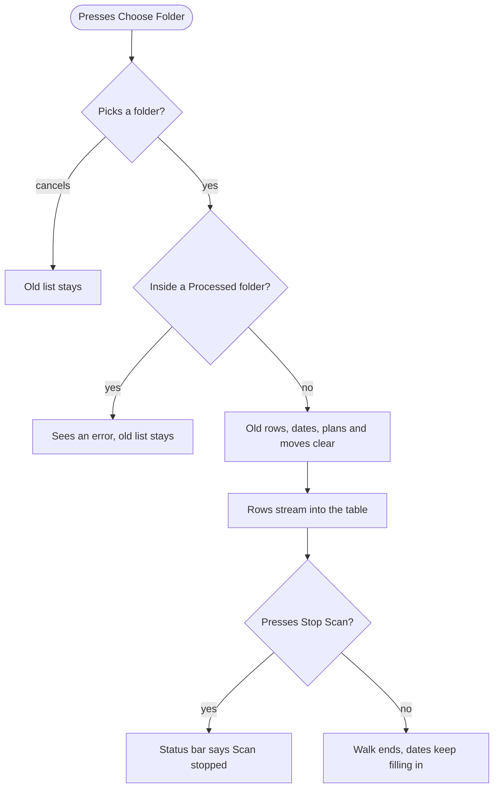
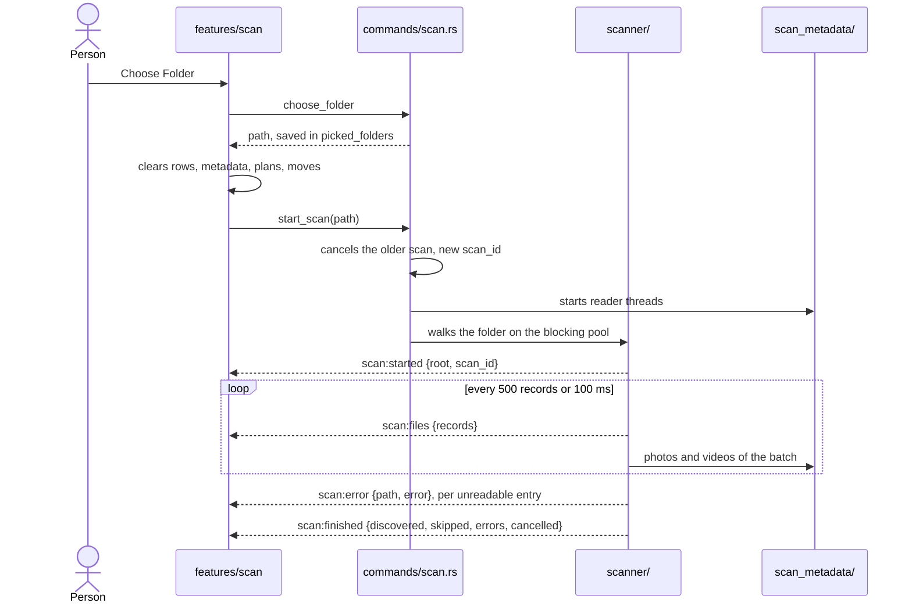
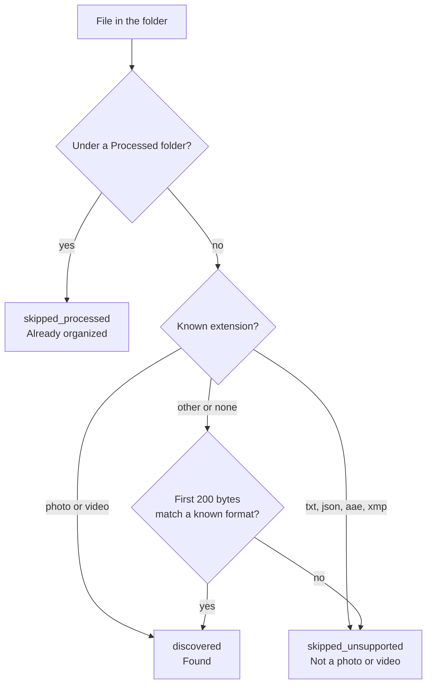

# Scan

The scan lists every file of the picked folder in the table while it walks the folder. It moves no files.

## What the person sees

- **Choose Folder** in the toolbar opens the system folder picker. It is disabled while files move, with the tooltip "Wait for the files to finish moving."
- **Stop Scan** shows while the scan runs. The table keeps the rows found so far.
- **From and To** under the toolbar show the picked folder and the destination root.
- **Rows** appear in batches. Each row starts as `Found`, `Already organized` or `Not a photo or video`.
- **A folder inside `Processed`** gets the error "Selected folder is inside a Processed path." The old list stays.

## User flow

## What happens inside

1. `choose_folder` opens the picker with a callback, so the UI thread doesn't block. The picked path joins `picked_folders`. Only these folders may start a move.
2. `start_scan` checks the path with `path_safety.rs`, cancels any older scan and gets a new `scan_id`.
3. `scanner/` walks the folder with `WalkDir`. It sorts each file into a record and sends records in batches.
4. Each batch of photos and videos goes straight to [capture dates](./capture-dates.md).
5. `cancel_scan` sets the cancel token. The walk flushes its batch and sends `scan:finished` with `cancelled: true`.

## How a file is sorted

- **Photos** `jpg`, `jpeg`, `png`, `heic`, `heif`, `tif`, `tiff`, `webp`.
- **Videos** `mp4`, `mov`, `m4v`, `avi`, `mts`, `m2ts`.
- **First bytes** spot JPEG, PNG, WebP, AVI, HEIC, MP4, MOV and MPEG-TS. A file named `name(IMG_1.jpg)` gets its real extension when it moves. TIFF isn't sniffed.
- **Unreadable entries** the walk sends `scan:error` for each one and counts it in `scan:finished.errors`.

## Old scans

A new scan replaces the old one at once.

- **Frontend** `useReplacedScanFilter` drops events of the replaced folder. It keeps the `scan_id` in a ref, so an event that lands before the next render can't reach the new list.
- **Backend** the new scan cancels the old walk and its reads. A command with the old `scan_id` fails.
- **Rows** `useScanRows` drops duplicate ids and renders new rows every 250 ms. The last batch flushes before the scan counts as done.

## Code

| Side     | Files                                                                               |
| -------- | ----------------------------------------------------------------------------------- |
| Frontend | `src/features/scan/`, `src/lib/api/scan.ts`                                         |
| Commands | `src-tauri/src/commands/scan.rs`, `commands/system.rs`, `commands/folder_dialog.rs` |
| Backend  | `src-tauri/src/scanner/`, `picked_folders.rs`, `path_safety.rs`                     |
| Payloads | `src-tauri/src/models/scan.rs`                                                      |
| Spec     | `specs/001-organize-nas-media/`, `specs/002-streaming-queue-processing/`            |
