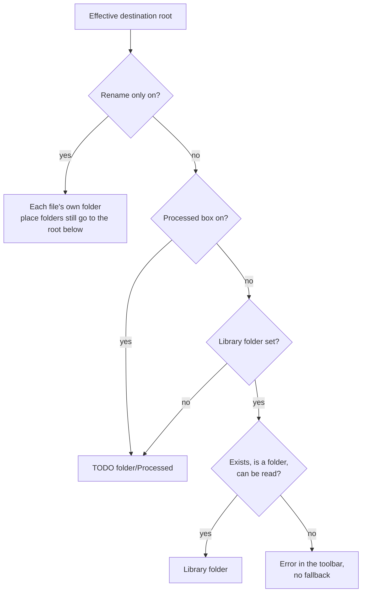
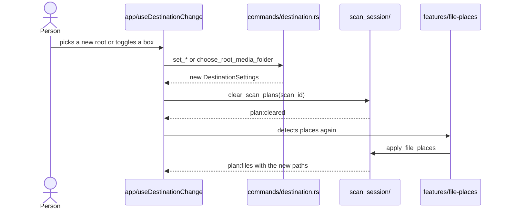
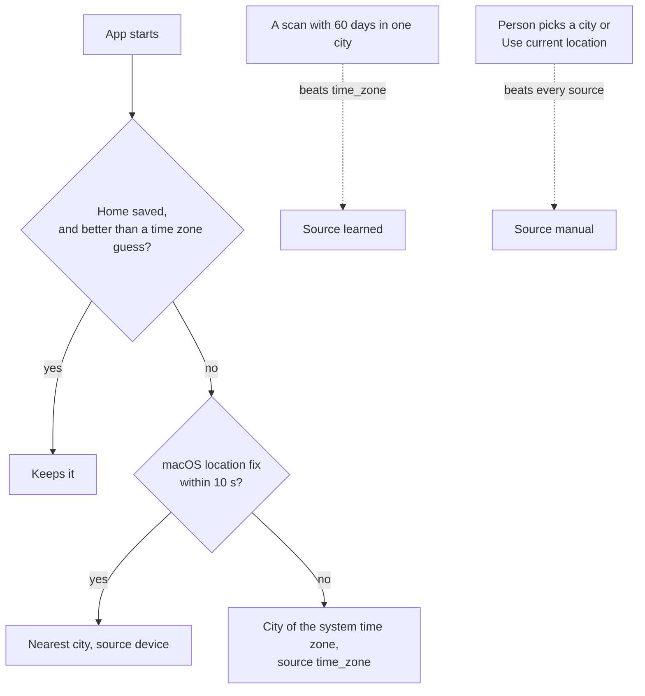

# Settings

Settings decide where files go and which place folders appear. They live in the Settings menu (the gear) and in two toolbar checkboxes. The backend saves them in `<appData>/settings/destination-settings.json`.

## What the person sees

| Control                                               | Where    | Effect                                                                |
| ----------------------------------------------------- | -------- | --------------------------------------------------------------------- |
| **Choose Library Folder** and **Clear**               | Settings | Sets or clears the library folder, the destination root               |
| **Use a Processed folder inside the scanned folder.** | Settings | Uses `<TODO folder>/Processed` and keeps the library folder for later |
| **Rename only**                                       | Toolbar  | Files keep their folder and only get the new name                     |
| **Group by place**                                    | Toolbar  | Photos with GPS go to place folders. On by default                    |
| **Home**: search, **Use current location**, **Clear** | Settings | Sets the home city, so home's country gets no country folder          |

- **Lock** once moves start, the root and both checkboxes lock with "Locked after you start moving files. Choose a folder again to change it."
- **Group by place with Rename only** the box shows unchecked and disabled, with the hint "Rename only keeps files in their folders."
- **Group by place tooltip** counts the files with a place, or says none has GPS.

## Which root the files go to

- **No silent fallback** a library folder that went missing shows an error. The app doesn't switch to `Processed` on its own.
- **One source** the toolbar shows the root from `get_effective_destination_root(selected_path)`. The frontend doesn't work it out.
- **Rename only and places** place folders go under the root the app would use with Rename only off. The history run records it as `place_root_path`, so undo checks it too.

## Changing a setting during a scan

The change works only before the move starts. After that the controls lock.

## Home

Home is the person's city. Photos there get no place folder. Photos elsewhere in home's country get a place folder and no country folder. [places.md](../places.md) has the full rules.

- **Source ranking** `manual` beats `device`, `device` beats `learned`, `learned` beats `time_zone`.
- **Search** finds cities 200 ms after typing stops, offline, up to 10 results. Accents and case don't matter.
- **The label** says where home came from, such as `from your location`.
- **A new home** makes `features/file-places` find places again, so the plans update.

## Saved file

`destination-settings.json` holds:

| Field                    | Meaning                                                         |
| ------------------------ | --------------------------------------------------------------- |
| `version`                | File format version. An unknown version loads the defaults      |
| `root_media_folder`      | The library folder, or `null`                                   |
| `force_processed_folder` | The Processed box                                               |
| `rename_in_place`        | Rename only                                                     |
| `group_by_place`         | Group by place, default `true`                                  |
| `home`                   | `name`, `country`, `latitude`, `longitude`, `source`, or `null` |
| `updated_at`             | Time of the last change                                         |

Writes go through a temp file and a process lock, so a crash leaves the old file or the new one.

## Commands

| Command                                                                   | Does                                    |
| ------------------------------------------------------------------------- | --------------------------------------- |
| `get_destination_settings`                                                | Loads the settings                      |
| `get_effective_destination_root(selected_path)`                           | Resolves the root for the picked folder |
| `choose_root_media_folder`, `clear_root_media_folder`                     | Sets or clears the library folder       |
| `set_force_processed_folder`, `set_rename_in_place`, `set_group_by_place` | Saves one flag                          |
| `search_home_cities`, `set_home_location`, `use_current_location`         | Home section                            |

## Code

| Side     | Files                                                                                                  |
| -------- | ------------------------------------------------------------------------------------------------------ |
| Frontend | `src/features/destination-settings/`, `src/features/home-location/`, `src/app/useDestinationChange.ts` |
| Commands | `src-tauri/src/commands/destination.rs`, `commands/home.rs`                                            |
| Backend  | `src-tauri/src/settings/`, `home_location/`                                                            |
| Payloads | `src-tauri/src/models/destination.rs`, `models/home.rs`                                                |
| Spec     | `specs/004-custom-media-root/`                                                                         |
