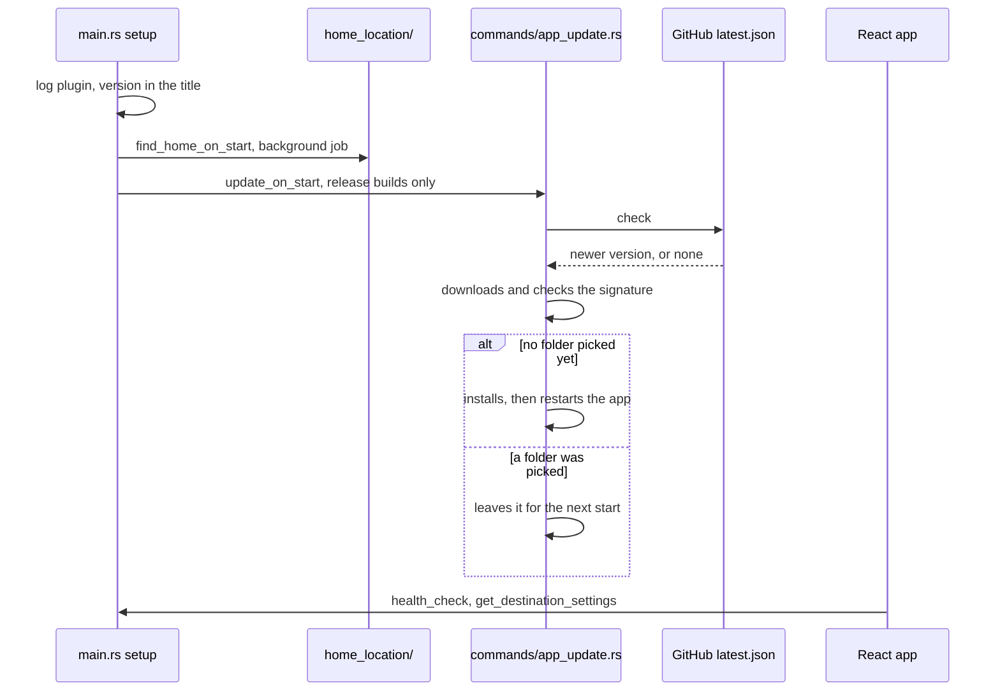

# Updates and logs

The desktop app updates itself on start from the latest GitHub release. It logs scans, moves and errors to the console and to a file.

## What the person sees

- **Window title** shows the app name and version, such as `Media Organizer 0.2.14`. Local builds show `0.2.0`.
- **While updating** the title reads `Media Organizer 0.2.14, updating to 0.2.15`.
- **After the update** the app restarts on the new version with no prompt.
- **During work** once a folder is picked, the download waits and installs on the next start.
- **Windows console** the console window shows the backend log, titled `Media Organizer <version> backend log`.

## Start up

- **Signed builds** the updater checks each download against the public key in `tauri.conf.json`.
- **Debug builds** skip the check.
- **Errors** a failed check only logs a warning. The app keeps running.
- **Release side** each push to `main` builds the installers and `latest.json`. [README.md](../../README.md#release) has the steps.

## Logs

| OS      | Folder                                           |
| ------- | ------------------------------------------------ |
| macOS   | `~/Library/Logs/com.mediaorganizer.desktop`      |
| Windows | `%LOCALAPPDATA%\com.mediaorganizer.desktop\logs` |

- **Level** `info` by default. Per-file scan and plan lines are `debug` and stay out.
- **Rotation** a file stops at 5 MB. The app keeps 5 old files.
- **Content** one line per event: scans, moves, undo and redo steps, errors and ExifTool warnings. Panics are logged too.
- **Time** in local time.

## Code

| Part      | Files                                                     |
| --------- | --------------------------------------------------------- |
| Start up  | `src-tauri/src/main.rs`, `console_title.rs`               |
| Update    | `src-tauri/src/commands/app_update.rs`, `tauri.conf.json` |
| Log lines | `src-tauri/src/events.rs`, `events/log_lines.rs`          |
| Release   | `.github/workflows/release.yml`                           |
