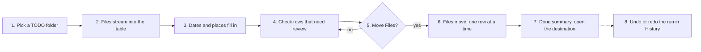
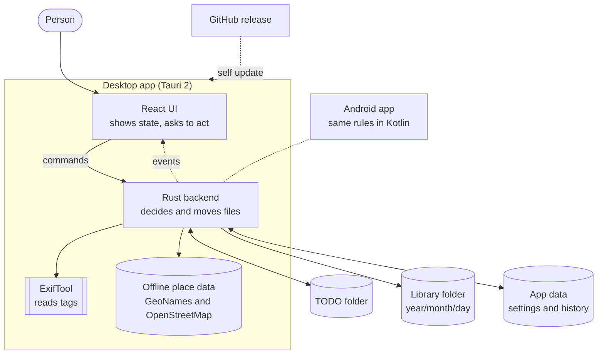

# Media Organizer at a glance

Media Organizer moves photos and videos into folders by the day they were taken. It renames each file so the name starts with the capture time. It runs on Windows and macOS, with a separate Android app that follows the same rules.

## What a person gets

A folder of mixed camera files becomes a dated library:

```text
TODO/IMG_1234.jpg            ->  Library/2026/3/5/2026-03-05 10-00-00 Kyoto, Japan (IMG_1234) - Pixel 7.jpg
TODO/Trip/PXL_0042.mp4       ->  Library/2026/3/5/2026-03-05 18-12-40 Kyoto, Japan (PXL_0042) - Pixel 7.mp4
TODO/Home/DSC_0001.jpg       ->  Library/2026/4/1/2026-04-01 09-30-00 Sydney, Australia (DSC_0001) - X-T5.jpg
```

- **Dated folders** `year/month/day`, with no leading zeros.
- **Place folders** a photo with GPS goes to the folder of its place. A trip abroad also gets a country folder. Rules are in [places.md](./places.md).
- **Readable names** capture time, place, the original name in brackets, then the camera.
- **No surprises** files move only after the person confirms. Each run can be undone.

## The journey



1. **Pick** the person presses Choose Folder and picks a folder, for example on a NAS.
2. **Scan** the app walks the folder and lists every file at once.
3. **Read** ExifTool reads the capture date, camera and GPS of each photo and video. The app finds the place of each GPS point offline.
4. **Plan** the app works out the new folder and name of each file. It doesn't touch a file yet.
5. **Confirm** the person presses Move Files and confirms the count and the destination.
6. **Move** each file moves without replacing anything. A file that fails a check stays put and its row says why.
7. **Clean** empty source folders are removed after the run.
8. **History** every run is logged. Undo puts files back. Redo moves them again.

Each step has its own page in [features/](./features/README.md).

## The parts



- **React UI** in `src/` draws the table, the dialogs and the status bar. It doesn't decide where a file goes.
- **Rust backend** in `src-tauri/src/` scans, reads, plans, moves and logs. Only its `safe_fs` module changes files.
- **ExifTool** ships inside the app as a sidecar, a helper program the app starts itself. It only reads.
- **Place data** ships inside the app, so finding a place needs no network.
- **Android app** in `android/` shares no code. It copies the same rules by hand.

## Words used across the docs

| Word             | Meaning                                                                     |
| ---------------- | --------------------------------------------------------------------------- |
| TODO folder      | The folder the person picks. Its files are the input.                       |
| Destination root | Where dated folders go: the library folder, else `<TODO folder>/Processed`. |
| Rename only      | A mode where files keep their folder and only get the new name.             |
| Scan             | One pass over the TODO folder. Each scan has a `scan_id`.                   |
| Plan             | The new path of one file. Planning moves no files.                          |
| Run              | One confirmed batch of moves. History keeps one log per run.                |
| Home             | The person's home city. Places in home's country get no country folder.     |
| Place folder     | A folder named after where a photo was taken, such as `Kyoto`.              |

## Promises the app keeps

- **Ask first** moves, undo, redo and deleting a history entry wait for a yes.
- **No overwrite** a move fails rather than replace a file.
- **Copies keep the original** across disks the app copies, checks the bytes, and leaves the source.
- **Duplicates stay** a file whose bytes already sit at the destination doesn't move.
- **Deletes need proof** undo deletes a copy only when the original still has the same bytes.
- **Every move is logged** a run stops once its log can't record a step.

The code side of each promise is in [architecture.md](./architecture.md#file-safety-guarantees).

## Where data lives

| Data       | Place                                                       |
| ---------- | ----------------------------------------------------------- |
| Settings   | `<appData>/settings/destination-settings.json`              |
| History    | `<appData>/history/index.json` and `history/runs/*.jsonl`   |
| App log    | `~/Library/Logs/com.mediaorganizer.desktop` on macOS        |
| App log    | `%LOCALAPPDATA%\com.mediaorganizer.desktop\logs` on Windows |
| Place data | `src-tauri/assets/*.tsv.gz`, bundled into the app           |
