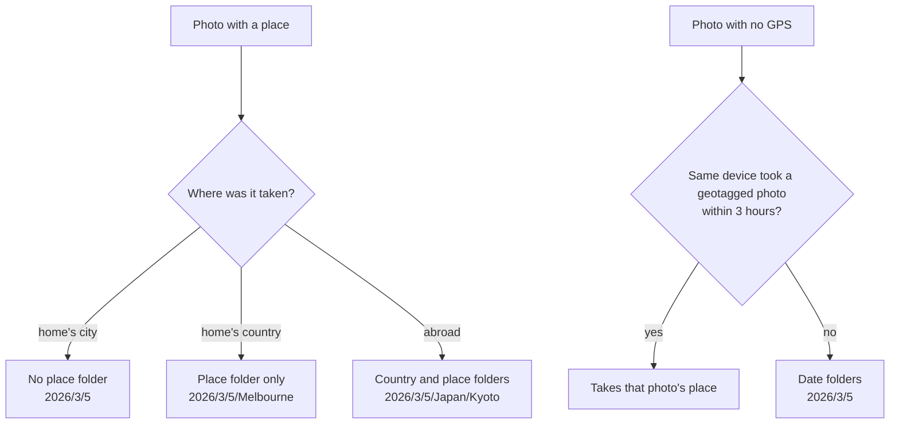
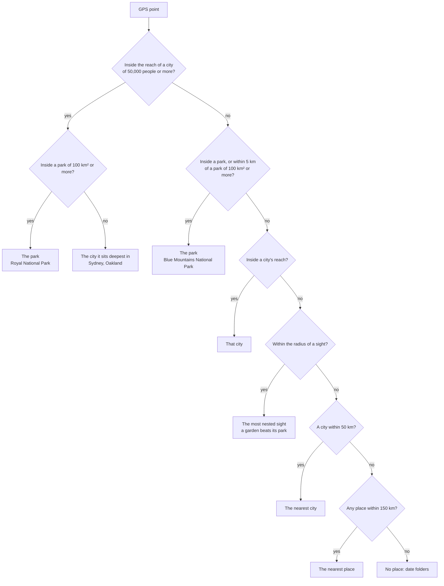
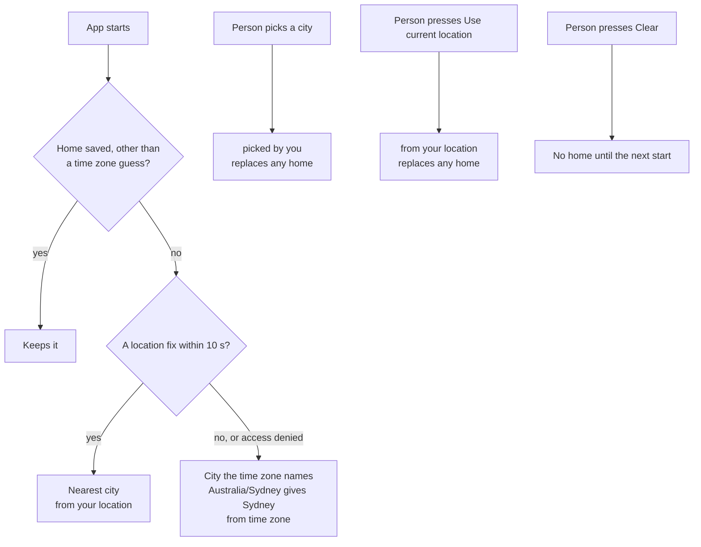
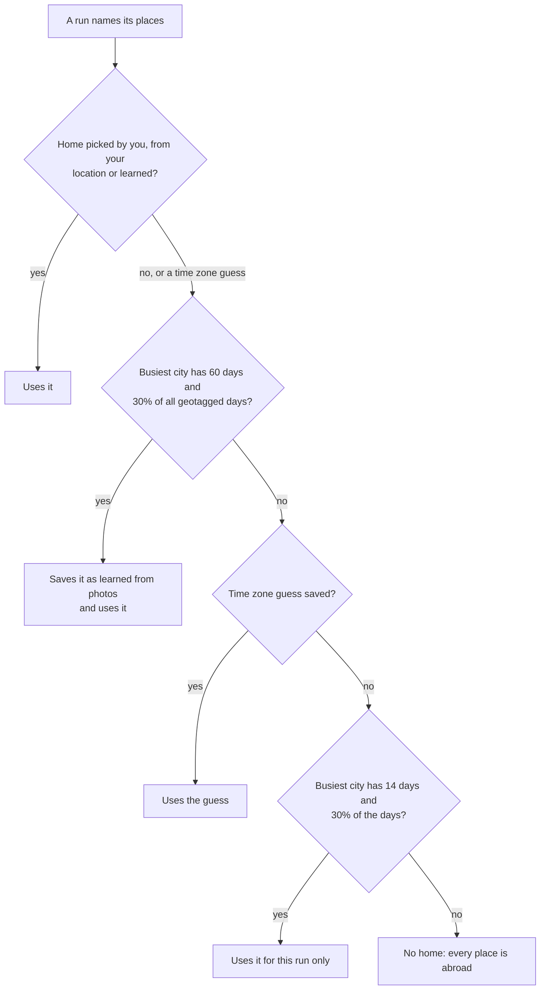
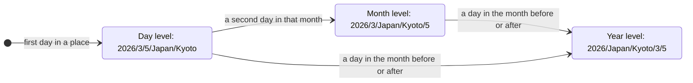
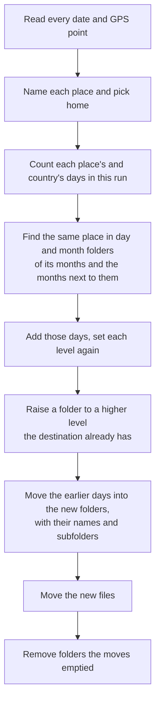
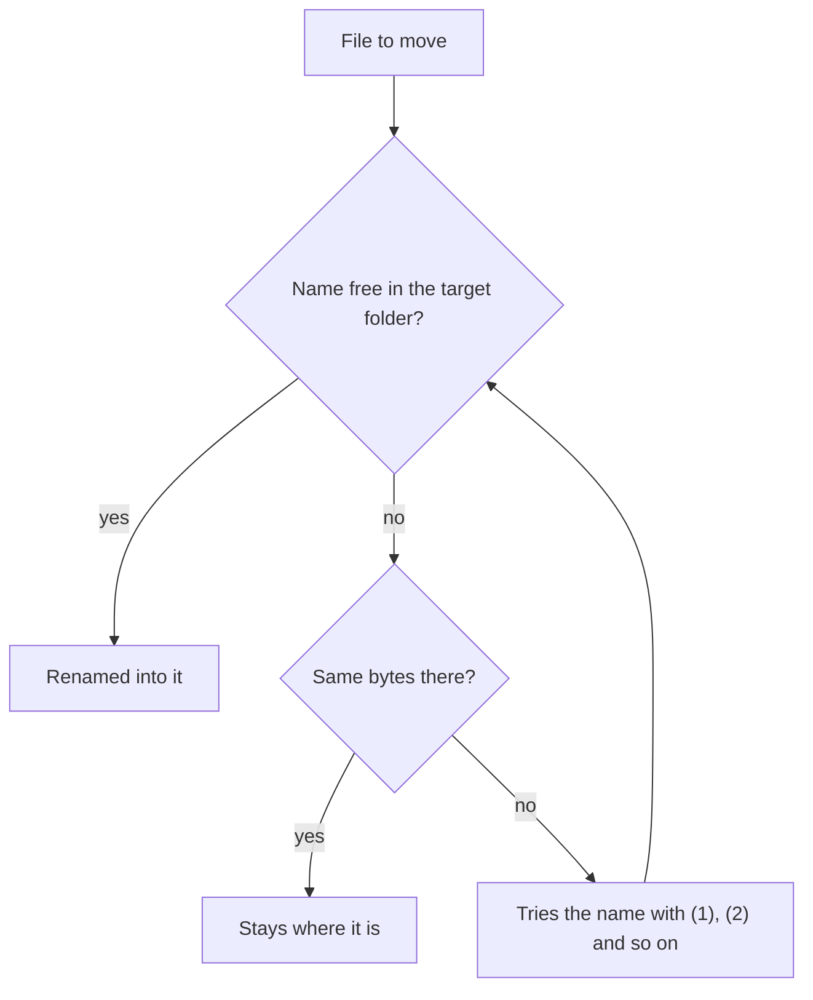

# How Photos Get Place Folders

Both apps put each photo and video with GPS into the folder of its place. The rules are the same on desktop and Android. This page explains them with diagrams. `docs/architecture.md` has the code side: commands, modules and events.

## The path a photo gets

A place folder sits inside the date folders, at the level its days span:

| Days of the place in one year | Level | Example                |
| ----------------------------- | ----- | ---------------------- |
| one day                       | day   | `2026/3/5/Japan/Kyoto` |
| more than one day, one month  | month | `2026/3/Japan/Kyoto/5` |
| more than one month           | year  | `2026/Japan/Kyoto/3/5` |

Home decides which folders appear at all:

- **Country and place** each get their own level. The country spans all its places, so it sits at the place's level or above: `2026/Japan/3/15/Osaka`.
- **Years** don't share a folder. Dec 31 and Jan 1 go to `2025/.../Kyoto` and `2026/.../Kyoto`.
- **Two places with one name** get their region: `Central Park (New York)`.
- **Names** get the Windows-safe form, so the folders copy to a PC or NAS.
- **File names** carry the place and country after the date, home's city included: `2026-03-05 10-00-00 Sydney, Australia (IMG_1234) - Pixel 7.jpg`. A place named like its country appears once: `Singapore`.

## How a GPS point gets its name

Both apps look the point up offline in `src-tauri/assets`: GeoNames cities and sights, and OpenStreetMap park outlines.

- **City reach** grows with population: about 18 km for San Francisco, 1.4 km for a town of 5,000.
- **Sight radii** stand in for outlines: 1 km for a garden, museum or summit, 1.5 km for a city park, 3 km for a beach or lake, 5 km for a volcano, 10 km for an island, 15 km for a reserve.
- **Country** comes from the nearest place, so a point near a border can get the neighbour.

## Where home comes from

Home has a source. A stronger source replaces a weaker one, and a weaker one waits:

- **Desktop** asks macOS for when-in-use location. **Android** asks once for approximate location. Both fall back to the time zone.
- **The Home section** in desktop settings and the Home row on the Android screen show home and its source.

## The home a run goes by

A small run is often one holiday, so a time zone guess beats its busiest city. A desktop preview saves no learned home, since the files read so far can point elsewhere.

## How a trip lifts its folder

Each run counts the days of a place in its own files. Then it looks for the same place in the destination and counts those days too. The level follows the total:

A trip to Kyoto, sorted after each day:

| After | Kyoto's files                                                  |
| ----- | -------------------------------------------------------------- |
| Mar 5 | `2026/3/5/Japan/Kyoto/a.jpg`                                   |
| Mar 6 | `2026/3/Japan/Kyoto/5/a.jpg`, `.../6/b.jpg`                    |
| Apr 2 | `2026/Japan/Kyoto/3/5/a.jpg`, `.../3/6/b.jpg`, `.../4/2/c.jpg` |

### Which earlier days count

The run looks in the months of its own days and the months right next to them, in the same year:

- **Next month** a Mar 2 photo finds `2026/2/Dubai/27` and lifts Dubai to the year: `2026/Dubai/2/27`, `2026/Dubai/3/2`.
- **Two months away** a Mar 7 photo leaves `2026/1/5/Dubai` alone and gets `2026/3/7/Dubai`.
- **Another year** a Jan 1 photo leaves `2025/12/31/Dubai` alone.
- **Same place only.** Kyoto on Mar 5 and Osaka on Mar 6, sorted on separate days, keep `Japan` at the day level for each. Sorted in one run, `Japan` spans both days and sits at the month.
- **Folders a level higher** win. One day in Osaka joins `2026/3/Osaka` or `2026/Osaka` when the destination already has it. The country is checked first, then the place inside it.

### One planning pass

- **Earlier days** are the photos and videos of the folders found. Other files stay, and so do files the scan itself holds.
- **The default destination** `<selected>/Processed` holds earlier days too. The scan skips `Processed` folders, so their files aren't scan files.
- **Desktop** lists the folders in the move confirmation, and its box can keep earlier days apart for one scan. **Android** always gathers them.

## Why no photo gets lost

Every move, new file or earlier day, goes through one check:

- **No overwrite.** The name is checked free right before the rename.
- **Stopping** at any point leaves each file in its old folder or its new one. Android's `TripTest` stops a run at every step and checks this.
- **Deletes** touch only folders the moves emptied.
- **Desktop** records every move in history, so undo can put files back.

## Every use case

Each row gives the folders before, the new photos and the result. Paths sit under the destination. Home is Sydney, Australia, unless a row says otherwise. The last column names the tests that prove the row:

- **D** a desktop test in `src-tauri/src`.
- **A** an Android test in `android/app/src/test`.

### Where one photo goes

| Case                           | Photo                          | Result                                              | Proved by                                                                                           |
| ------------------------------ | ------------------------------ | --------------------------------------------------- | --------------------------------------------------------------------------------------------------- |
| Home's city                    | Sydney, Mar 5                  | `2026/3/5`                                          | D `a_place_in_home_city_matches_home_city` · A `UseCasesTest`                                       |
| Home's country                 | Melbourne, Mar 6               | `2026/3/6/Melbourne`                                | D `a_place_in_home_country_matches_home_country` · A `UseCasesTest`                                 |
| Abroad                         | Frechen, Germany               | `.../Germany/Frechen`                               | D `every_geotagged_file_gets_its_place_with_a_foreign_country` · A `FilePlacesParityTest`           |
| No home known                  | a park by Liverpool, Australia | country and place folders: `.../Australia/<park>`   | D `with_no_home_every_place_is_away` · A `FilePlacesParityTest`                                     |
| No GPS, same phone 2.5 h later | after a Frechen photo          | Frechen's folder                                    | D `a_file_without_gps_joins_the_place_of_the_same_device_within_3_hours` · A `FilePlacesParityTest` |
| No GPS, same phone 3.5 h later | after a Frechen photo          | date folders                                        | the same tests                                                                                      |
| No GPS, another camera or none | 10 min after a Frechen photo   | date folders                                        | D `a_file_without_gps_from_another_device_stays_out` · A `FilePlacesParityTest`                     |
| No GPS in any file             | 6 photos                       | date folders                                        | D `files_without_gps_report_no_gps` · A `FilePlacesParityTest`                                      |
| Group by place off             | Kyoto, Mar 5                   | `2026/3/5`                                          | A `PlaceOrganizerTest`                                                                              |
| File name                      | Sydney, Mar 5                  | `2026-03-05 10-00-00 Sydney, Australia (IMG_1).jpg` | D `file_names_carry_the_place_and_country_home_city_included` · A `DestinationTest`, `TripTest`     |

### How the point gets its name

| Point                             | Name                                               | Why                                       | Proved by                                                                      |
| --------------------------------- | -------------------------------------------------- | ----------------------------------------- | ------------------------------------------------------------------------------ |
| Bondi, Chatswood, Manly           | Sydney                                             | a big city keeps small parks and suburbs  | D `harbour_suburbs_stay_sydney` · A `GeocoderTest`                             |
| Royal Botanic Garden, Sydney      | Sydney                                             | the city wins before sights               | D `a_place_in_home_country_matches_home_country` · A `FilePlacesParityTest`    |
| Garie Beach                       | Royal National Park                                | a park of 100 km² beats even a big city   | D `royal_national_park_beaches_are_the_park` · A `GeocoderTest`                |
| Katoomba, Blue Mountains lookouts | Blue Mountains National Park                       | a town within 5 km of a large park        | D `blue_mountains_towns_and_lookouts_are_the_national_park` · A `GeocoderTest` |
| Downtown Oakland                  | Oakland                                            | a city near its own centre keeps its name | D `a_city_with_its_own_centre_keeps_its_name` · A `GeocoderTest`               |
| City Hall, Twin Peaks, Alcatraz   | San Francisco                                      | inside a big city                         | D `san_francisco_sights_are_san_francisco` · A `GeocoderTest`                  |
| Yosemite Valley                   | a Yosemite place                                   | a park far from big cities                | D `yosemite_valley_is_in_a_yosemite_place` · A `GeocoderTest`                  |
| Mid Pacific                       | none, date folders                                 | no place within 150 km                    | D `mid_pacific_has_no_place` · A `GeocoderTest`                                |
| Two parks named Central Park      | `Central Park (New York)`, `Central Park (Oregon)` | one name, two places                      | A `DetectionTest`                                                              |

### A trip, sorted after each day

Kyoto, Japan, home in Sydney. The automatic moves on Android sort this way, and so does a desktop scan of each day.

| Case                    | Before                       | New photo      | Result                 | Earlier days move to           | Proved by                                                                             |
| ----------------------- | ---------------------------- | -------------- | ---------------------- | ------------------------------ | ------------------------------------------------------------------------------------- |
| First day               | nothing                      | Mar 5          | `2026/3/5/Japan/Kyoto` | nothing moves                  | A `TripTest`                                                                          |
| Same day, later         | `2026/3/5/Japan/Kyoto`       | Mar 5, evening | `2026/3/5/Japan/Kyoto` | nothing moves                  | A `UseCasesTest`                                                                      |
| Second day              | `2026/3/5/Japan/Kyoto`       | Mar 6          | `2026/3/Japan/Kyoto/6` | `2026/3/Japan/Kyoto/5`         | D `an_earlier_day_of_the_place_moves_with_the_run_and_its_folder_goes` · A `TripTest` |
| Third day               | `2026/3/Japan/Kyoto/5`, `/6` | Mar 7          | `2026/3/Japan/Kyoto/7` | nothing moves                  | A `UseCasesTest`                                                                      |
| Next month              | `2026/3/Japan/Kyoto/5`, `/6` | Apr 2          | `2026/Japan/Kyoto/4/2` | `2026/Japan/Kyoto/3/5`, `/3/6` | A `TripTest`                                                                          |
| Earlier month next door | `2026/2/Dubai/27`            | Dubai, Mar 2   | `2026/Dubai/3/2`       | `2026/Dubai/2/27`              | D `a_day_of_the_next_month_raises_the_place_to_its_year` · A `NearbyFoldersTest`      |
| Two months away         | `2026/1/5/Dubai`             | Dubai, Mar 7   | `2026/3/7/Dubai`       | nothing moves                  | D `a_day_two_months_away_stays_apart` · A `NearbyFoldersTest`                         |
| New year                | `2025/12/31/Dubai`           | Dubai, Jan 1   | `2026/1/1/Dubai`       | nothing moves                  | D `years_dont_share_a_folder` · A `NearbyFoldersTest`                                 |
| A year later            | `2025/3/5/Japan/Kyoto`       | Mar 6, 2026    | `2026/3/6/Japan/Kyoto` | nothing moves                  | A `UseCasesTest`                                                                      |

The same trip in one run gets the same folders at once, with nothing to move: D `a_place_over_days_of_one_month_sits_in_the_month`, `a_country_and_place_over_months_sit_in_the_year` · A `PlaceFoldersTest`.

### Countries and several cities

| Case                                  | Photos                                     | Result                                                                    | Proved by                                                                                                   |
| ------------------------------------- | ------------------------------------------ | ------------------------------------------------------------------------- | ----------------------------------------------------------------------------------------------------------- |
| Two cities on one day, one run        | Kyoto and Osaka on Mar 15, Tokyo on Apr 20 | `2026/Japan/3/15/Kyoto`, `2026/Japan/3/15/Osaka`, `2026/Japan/4/20/Tokyo` | D `places_of_one_day_sit_in_that_day_inside_a_longer_country` · A `PlaceFoldersTest`                        |
| Two cities on two days, one run       | Kyoto on Mar 5, Osaka on Mar 6             | `2026/3/Japan/5/Kyoto`, `2026/3/Japan/6/Osaka`                            | A `UseCasesTest`                                                                                            |
| Two cities on two days, separate runs | Kyoto on Mar 5, then Osaka on Mar 6        | `2026/3/5/Japan/Kyoto`, `2026/3/6/Japan/Osaka`                            | A `UseCasesTest`                                                                                            |
| The country follows its place up      | `2026/3/4/UAE/Dubai`, then Dubai on Mar 7  | `2026/3/UAE/Dubai/7`, earlier day to `2026/3/UAE/Dubai/4`                 | D `the_country_folder_moves_up_with_its_place` · A `NearbyFoldersTest`                                      |
| A weekend in home's country           | Melbourne on Mar 7, then Mar 8             | `2026/3/Melbourne/7`, `2026/3/Melbourne/8`                                | A `UseCasesTest`                                                                                            |
| Home's country over months, one run   | Melbourne on Mar 15 and Jun 1              | `2026/Melbourne/3/15`, `2026/Melbourne/6/1`                               | D `a_place_in_home_country_has_no_country_and_files_with_no_place_keep_date_folders` · A `PlaceFoldersTest` |

Separate runs don't lift a country for a different city: lifting looks for the same place only.

### Folders the destination already has

| Already there      | New photo            | Result                               | Proved by                                                                              |
| ------------------ | -------------------- | ------------------------------------ | -------------------------------------------------------------------------------------- |
| `2026/3/Osaka/14`  | Osaka, Mar 15        | `2026/3/Osaka/15`                    | D `one_day_joins_the_place_folder_of_its_month` · A `NearbyFoldersTest`                |
| `2026/Osaka/1/2`   | Osaka, Mar 15        | `2026/Osaka/3/15`                    | D `one_day_joins_the_place_folder_of_its_year` · A `NearbyFoldersTest`                 |
| `2026/Japan/Kyoto` | Kyoto, Mar 15        | `2026/Japan/Kyoto/3/15`              | D `a_place_joins_the_existing_country_and_then_its_own_folder` · A `NearbyFoldersTest` |
| `2026/Japan/Kyoto` | Osaka, Mar 15        | `2026/Japan/3/15/Osaka`              | the same tests                                                                         |
| `2026/3/1/Osaka`   | Osaka, Mar 15 and 16 | `2026/3/Osaka/15`, `2026/3/Osaka/16` | D `a_deeper_folder_of_the_same_place_is_left_alone` · A `NearbyFoldersTest`            |

A folder sits only as high as the destination has it. A deeper folder doesn't pull new days down. Photos in it count as an earlier day and move up.

### What moves with an earlier day

| In the earlier day's folder                                | What happens                                        | Proved by                                                                                             |
| ---------------------------------------------------------- | --------------------------------------------------- | ----------------------------------------------------------------------------------------------------- |
| Photos and videos                                          | move with their names                               | D `an_earlier_day_of_the_month_moves_into_the_month_folder` · A `NearbyFoldersTest`                   |
| A subfolder such as `Edits/b.jpg`                          | comes along: `2026/3/Dubai/4/Edits/b.jpg`           | A `NearbyFoldersTest`                                                                                 |
| Other files such as `notes.txt`                            | stay                                                | D `files_in_the_scanned_folder_and_other_files_stay_out_of_the_library_moves` · A `NearbyFoldersTest` |
| Hidden files such as `.hidden.jpg`                         | stay                                                | A `TripTest`                                                                                          |
| Files the scan holds, when it scans inside the destination | plan with the scan                                  | D `files_in_the_scanned_folder_and_other_files_stay_out_of_the_library_moves` · A `NearbyFoldersTest` |
| Files in the default destination `<selected>/Processed`    | move                                                | D `earlier_days_in_the_processed_folder_of_the_scanned_folder_move` · A `NearbyFoldersTest`           |
| The folders left empty                                     | removed, up to the destination                      | D `an_earlier_day_of_the_place_moves_with_the_run_and_its_folder_goes` · A `TripTest`                 |
| Desktop: the box keeps earlier days apart                  | the new photo goes to its day folder, nothing moves | D `leaving_earlier_days_apart_plans_the_day_folder_again`                                             |

### Home

| Case                                 | Saved before               | What happens                          | Saved after                  | Proved by                                                                         |
| ------------------------------------ | -------------------------- | ------------------------------------- | ---------------------------- | --------------------------------------------------------------------------------- |
| First start                          | nothing                    | a fix in Perth                        | Perth, from your location    | D `startup_saves_a_device_home_when_none_is_saved` · A `HomeParityTest`           |
| Location denied or no fix            | nothing                    | zone `Australia/Sydney`               | Sydney, from time zone       | D `without_a_fix_the_time_zone_names_home` · A `HomeParityTest`                   |
| Zone with a region in the middle     | nothing                    | zone `America/Argentina/Buenos_Aires` | Buenos Aires, from time zone | the same tests                                                                    |
| Zone that names no city              | nothing                    | zone `Etc/UTC`                        | nothing                      | the same tests                                                                    |
| Start with a time zone guess         | Sydney, from time zone     | a fix in Perth                        | Perth, from your location    | D `startup_replaces_a_time_zone_guess_and_skips_other_homes` · A `HomeParityTest` |
| Start with any other home            | Sydney, learned            | no lookup at all                      | Sydney, learned              | the same tests                                                                    |
| Use current location                 | Sydney, picked by you      | a fix in Perth                        | Perth, from your location    | D `current_location_replaces_a_picked_home`                                       |
| Use current location without a fix   | Sydney, picked by you      | the app explains why                  | Sydney, picked by you        | D `current_location_without_a_fix_keeps_home_and_explains` · A `HomeParityTest`   |
| Pick a city                          | anything                   | picks Zuerich                         | Zuerich, picked by you       | D `HomeCitySearch.test.tsx`                                                       |
| A run with 60 days in Liverpool      | nothing                    | learns                                | Liverpool, learned           | D `a_scan_with_60_days_at_home_saves_it_as_learned` · A `HomeParityTest`          |
| The same run                         | Sydney, from time zone     | learns                                | Liverpool, learned           | D `a_scan_with_60_days_at_home_replaces_a_time_zone_guess` · A `HomeParityTest`   |
| The same run                         | Sydney, from your location | keeps                                 | Sydney, from your location   | D `a_scan_with_60_days_at_home_keeps_a_device_home` · A `HomeParityTest`          |
| A run with 90 days in Liverpool      | Houston, picked by you     | keeps                                 | Houston, picked by you       | D `a_large_scan_keeps_the_saved_home` · A `HomeParityTest`                        |
| 59 days in Liverpool, 10 in Houston  | nothing                    | Liverpool is home for this run only   | nothing                      | D `a_smaller_scan_infers_home_for_itself_and_saves_none` · A `HomeParityTest`     |
| A 20 day trip to Houston             | Sydney, from time zone     | Houston files get `United States`     | Sydney, from time zone       | D `a_time_zone_guess_puts_a_trip_abroad_in_its_country` · A `HomeParityTest`      |
| 13 days in one city                  | nothing                    | too few days                          | nothing                      | D `too_few_days_give_no_home` · A `FilePlacesParityTest`                          |
| 14 days, with 40 more days elsewhere | nothing                    | under 30% of the days                 | nothing                      | D `a_small_share_of_days_gives_no_home` · A `FilePlacesParityTest`                |
| Desktop preview with 60 days         | Sydney, from time zone     | saves nothing yet                     | Sydney, from time zone       | D `a_preview_saves_no_learned_home`                                               |
| Clear                                | anything                   | forgets it                            | nothing until the next start | no test yet                                                                       |

### Photo safety

| Case                                  | What happens                                  | Proved by                                                                                           |
| ------------------------------------- | --------------------------------------------- | --------------------------------------------------------------------------------------------------- |
| The name is taken by a different file | the moved file gets ` (1)`: `a (1).jpg`       | D `applies_suffix_for_existing_destination_file` · A `TripTest`                                     |
| A file with the same bytes is there   | the file stays where it is                    | D `blocks_conflict_when_existing_destination_has_identical_content` · A `TripTest`, `OrganizerTest` |
| Two files of one run want one name    | the second gets ` (1)`                        | D `applies_suffix_for_duplicate_in_same_run`                                                        |
| The run stops at any point            | each file is in its old folder or its new one | A `TripTest`                                                                                        |
| Desktop: undo                         | the files go back                             | D `moves_a_batch_records_history_and_undoes_it`                                                     |

## Where the code lives

| Rule                     | Desktop, `src-tauri/src/`        | Android, `android/app/src/main/java/com/mediaorganizer/android/` |
| ------------------------ | -------------------------------- | ---------------------------------------------------------------- |
| Naming a point           | `geo/`                           | `geo/`                                                           |
| Place of each file, home | `file_places/`, `home_location/` | `places/`, `location/`                                           |
| Levels, earlier days     | `planner/`                       | `places/`                                                        |
| The move itself          | `move_run/`, `safe_fs/`          | `organize/`                                                      |

A change to one side needs the same change on the other. `docs/agent/android-parity.md` says how.
