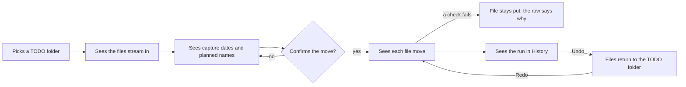
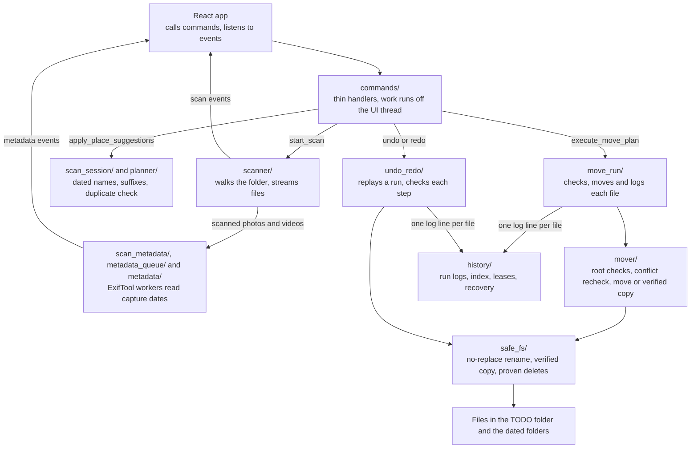

# Media Organizer backend

The Rust backend makes every decision about files. The React app shows the events it streams and sends back what the user confirmed.

Rules and the full list of safety guarantees are in [`docs/architecture.md`](../docs/architecture.md). This page is the map.

## Layers

Each layer uses only the layers below it.

| Layer    | Code in `src/`                                                                                                       | Job                                                      |
| -------- | -------------------------------------------------------------------------------------------------------------------- | -------------------------------------------------------- |
| Entry    | `main.rs`                                                                                                            | Registers state and commands with Tauri                  |
| Commands | `commands/`                                                                                                          | Thin async handlers that run file work off the UI thread |
| Features | `scanner/`, `metadata/`, `metadata_queue/`, `planner/`, `mover/`, `move_run/`, `history/`, `undo_redo/`, `settings/` | One job each, given paths, stores and an `EventSink`     |
| Shared   | `models/`, `events.rs`, `path_safety.rs`, `file_ops/`, `safe_fs/`, `filename/`                                       | Payloads, event names, path checks and file mutations    |

- **Tauri stays at the edge.** Only `main.rs`, `commands/` and `events.rs` see `AppHandle`. Tests pass a `RecordingSink` where the app passes the window.
- **Payloads match the React app.** `cargo test` writes `models/` as TypeScript into `src/lib/types/generated/`. Event names in `events.rs` match `src/lib/api/`.
- **Errors cross as text.** A command returns `Result<_, String>`. Enums exist only where code branches on the error kind.

## Main flows

1. **Scan.** `start_scan` cancels any older scan and walks the folder off the UI thread. `scanner` streams `scan:*` events and marks files under `Processed` as skipped.
2. **Metadata.** `scan_metadata` reads each scanned batch of photos and videos on long-lived ExifTool processes and streams `metadata:*` events. `metadata` picks the capture date by tag priority.
3. **Plan.** `scan_session` plans each file once its date is read and `apply_place_suggestions` gave the place folders. Planning is a dry run. `planner` streams `plan:*` events with names like `<root>/2024/3/5/<date> (<original>) - <device>.jpg`. It adds `(n)` on a name clash and blocks a file whose bytes already sit there. In rename only mode the name is the same and the folder is the file's own.
4. **Move.** `execute_move_plan` starts only from a folder picked in the native dialog. `move_run` opens a history run, checks and moves each file through `mover`, logs one line per file and streams `move:*` events.
5. **History, undo and redo.** `history` keeps one JSONL log per run in appData plus an index of the newest 200. `undo_redo` replays a run in either direction, checks each step against the disk and logs it to the same file.

## How files stay safe

- **Only `safe_fs` changes files.** `clippy.toml` rejects raw rename, copy, delete and truncating writes everywhere else.
- **Moves don't overwrite.** A move is an exclusive rename. Across volumes the file is copied to a temp file and compared with the source before it takes the name. The source stays.
- **Deletes need proof.** Undo deletes a copy only when the kept source holds the same bytes. Cleanup removes only empty real folders, the picked folder included once it is empty. It skips links and the destination root.
- **A log failure stops the run.** A move run or a replay stops moving files once its log can't record a step. One job works on a run at a time.
- **Paths stay inside their roots.** Sources stay inside the picked folder. Destinations stay inside the destination root. Replays stay inside the folders the run recorded.

## User flow



## What happens inside



## Reading order

1. `models/` and `events.rs`, to learn the payloads the React app sees.
2. `commands/`, to see which module each button reaches.
3. `scanner/`, `metadata/` and `planner/`, the read-only half.
4. `safe_fs/`, then `mover/` and `move_run/`, the half that changes files.
5. `history/` and `undo_redo/`, then `settings/`, `clippy.toml` and the `tests/` folders.

## Checks

```sh
mise x -- cargo test --manifest-path src-tauri/Cargo.toml
mise x -- cargo clippy --manifest-path src-tauri/Cargo.toml --all-targets -- -D warnings
mise x -- cargo fmt --manifest-path src-tauri/Cargo.toml
```
