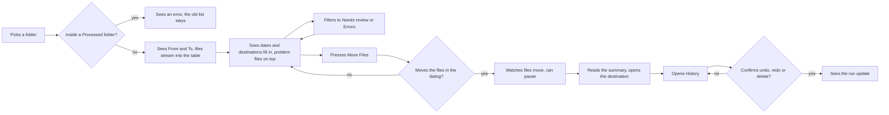
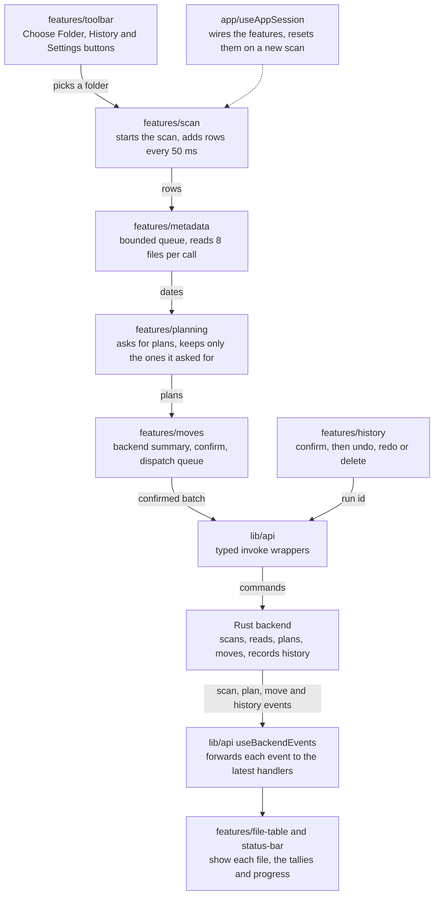

# Frontend

The React app shows what the Rust backend reports and asks the backend to act. Only the backend touches files, and files move only after the person confirms.

## How the pieces fit

- **App shell** `main.tsx` mounts `App.tsx`. `App.tsx` lays out the toolbar, the file table and the status bar.
- **Wiring** `app/useAppSession.ts` builds each feature hook and passes data between them. A new scan resets metadata, plans and moves there.
- **Features** each folder in `features/` owns one pipeline step or one screen. `moves` is a step and `file-table` is a screen.
- **Bridge** `lib/api/` wraps every Tauri command and event name. `lib/types/` copies the Rust payloads in `src-tauri/src/models/`. Change them together with the backend.
- **Primitives** `components/design-system/` holds the button, the dialog, the pane and the resizable virtual table.

## How backend events drive state

The backend streams progress as events instead of returning one big result.

1. A feature hook calls a command, such as `start_scan` or `create_move_plan`.
2. The backend runs the job and emits `scan:*`, `plan:*`, `move:*` or `history:*` events.
3. `useBackendEvents` attaches the listeners once and hands each event to the handlers from the latest render.
4. The feature hook stores the payload. Scan rows and plans land in 50 ms batches, so a big folder renders in chunks.
5. Tables and tallies are worked out from that state. No component keeps a second counter.

The hooks keep these rules:

- **Backend decides** the frontend shows plans and results as the backend sends them. It doesn't guess a destination or an outcome. The destination folder in the toolbar comes from `get_effective_destination_root`.
- **Ask first** every action that moves files or drops their history waits for a yes. The move dialog shows the destination and the backend's own count from `get_move_confirmation_summary`. History actions still use `window.confirm`.
- **Old events** plan events carry no request id, so planning keeps only plans for files it asked for. A metadata batch from an earlier scan is dropped.
- **Locks** the destination root locks once moves are confirmed. Choose Folder is disabled while a batch runs.

## Import rules

ESLint enforces these in `eslint.config.js`.

- **Features** import another feature only through its `index.ts`, and don't import `app/`.
- **App** imports features only through their `index.ts`.
- **Shared code** in `lib/` and `components/` doesn't import features or `app/`.
- **File size** each file does one job in about 100 lines. Tests sit next to the file they test.

## User flow

[Open the diagram](https://mermaid.live/view#pako:eNpNkt1u2zAMhV-F0LX7Ar3YsLZxkyb9QTdgF_MuNItehEmiQcotgqbvPkqxm15aPOcjeeg305NDc2mGQK_93nKG3XOXAL796syT7_8JWBgoOOTO_IaLiy9w9daZTRLvUEtPTD2KoJtFXzvzXuxXRXo8oBzhWknfERWUAJmJG8h7BJVD8JJBsj2Iws-2REe4WVwtU1Srgx_UwOCDPklmtBF8ylRR2f4JOBNu6oyrxe1srp0dOJTsk82ekhROUH8DI5N64wymBJnGmbSqpFZJrQ8ZWbQGD4hOgPHF4ysQw6ostEzfnnqfzbclRC75CNzTC0Jb2szq2ypZa5qlJHWT0xg-1Q_nbaC_S6Lrj2hW588a8Ea7_LS536PMgKjABnoNfLSTLNFsasM7VT-jdaeGMsVo-dAAjZhOT5-Cmo131bhV42NVrfVsxIe5uq3Vne5xTWnwHAWm5PRYjI5KRg4DZlz22J0Hv1-uVNrylGAay71m7u5j4W2XTGMicrTe6b-qrdQRVXjZGYeDnUJWunn_D0Qk6gk)

## What happens inside

[Open the diagram](https://mermaid.live/view#pako:eNpVVEtv2zAM_iuEzs6yy4ChGArsiZ7X3eYdZIuuhciipkeNoOl_HynZaXaJJFr8HiSVFzWSQXUHanK0jrOOGX596z1AJnKDjr97NaHOJWI6bqFPQzzef52JEsIPcgZjBw82ZYpn0N7AI-Zs_VOCoeRMPvXqDxwO95dgx1MCDVPNuUAatX8gOglbwpQseWbTIRxLws8hPLZYpVstC4A8I-xqOuAfzDW4AHkG9rhW0Er47nD_P8O2vzUksQqfMhtv-BLrQBuTINKaAJ-RfX14D8vViMQvsGDWAizrLaicjc66Ag9UvEEDfwsWFMmacT_CZB3bCRhh1M7tuJyFDBwcW2BgWW-B5ey5sBVYJ67lRLHe4mKcEEPiMrhzdUGe8W0GvsbsfO_aBLnO4ukZU1Uvm__kS6Bp1-MJuZ-pLIuO5w5G8pONSwfGpqDzODdbO_T2mfkG-XgBHaxQzG02bkm2UKW5orJuD1wukjoZAjZn0GG-EsTiwZorLi-M6exw5F2FyufA7NY_0wlhjTxKGNObPLbhDZvfjHHyz5LyfmyDMNZq1j51e21rSSQ4UuT2beIZV1TsVRKKXrXpkbyWVh_EliCj5DPruWy7N_XAE_-lAX2vn6oYbtuqhRE117rm8LOs_XUyKhlmhnfNo2hpsCIFir2tt8zbIevBNUE87rmkw_6W00xr45B7tRGQeS4tz5BcD5GeGEVYVAdqwbhoa-RP46VX8vy4Q3e9Mjjp4nKvXtXrP0X7i68)

## Checks

Run them through `mise`, from the repo root:

- **Tests** `mise x -- pnpm test`
- **Lint** `mise x -- pnpm lint`
- **Build** `mise x -- pnpm build`
